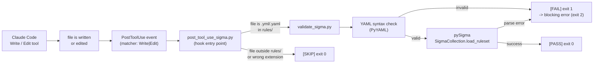

English | [Türkçe](README_TR.md)

# Sigma Detection Engineering Prototype with Claude Code PostToolUse Hook

A prototype that demonstrates automated Sigma rule validation integrated into the Claude Code editor workflow via a PostToolUse hook.

---

## Project Overview

This repository is a controlled detection engineering demonstration built around a single Sigma rule: detecting abuse of `certutil.exe` for remote file download. The project adds a Claude Code PostToolUse hook that automatically validates any Sigma rule after it is written or edited inside the `rules/` directory.

The goal is to show how AI-assisted coding tools can enforce detection engineering quality gates without manual intervention.

---

## Problem Statement

Detection engineers who write Sigma rules in an AI-assisted editor have no built-in guard against committing syntactically broken or structurally invalid YAML. A rule that fails to parse is silently committed and only breaks downstream when a SIEM or backend tries to compile it.

This prototype closes that gap by running a validation script automatically every time Claude Code writes or edits a file in the `rules/` directory.

---

## What This Prototype Does

- Provides a sample Sigma rule detecting `certutil.exe` URL downloads (`rules/suspicious_certutil_download.yml`).
- Provides a sample Sysmon process-creation event log with one simulated suspicious event and five benign events (`logs/sample_process_events.json`).
- Validates Sigma rules using **pySigma** (`sigma.collection.SigmaCollection.load_ruleset`), not the `sigma check` command, which is not yet implemented in sigma-cli 3.1.0.
- Runs a detection test harness (`scripts/test_detection.py`) that applies the rule's logic against the sample log and asserts expected match counts. **This harness is not a general Sigma engine** -- it only exercises the specific detection condition defined in this prototype.
- Hooks into Claude Code's PostToolUse event so that every `Write` or `Edit` tool call targeting a `.yml` or `.yaml` file inside `rules/` triggers validation automatically.

---

## Architecture and Workflow



**Flow summary:**

1. Claude Code calls `Write` or `Edit` on any file.
2. The file is written or edited to disk.
3. The PostToolUse hook fires if `tool_name` matches `Write` or `Edit`.
4. `post_tool_use_sigma.py` reads the hook JSON from stdin and checks whether the target file is a `.yml`/`.yaml` inside `rules/`. Anything else is skipped with exit code 0.
5. For matching files, `validate_sigma.py` is invoked as a subprocess.
6. `validate_sigma.py` first checks YAML syntax with PyYAML, then parses the rule through pySigma's `SigmaCollection.load_ruleset`.
7. Exit code 0 signals success. Exit code 2 signals a blocking error, which causes Claude Code to halt further workflow progression and display the validation output. Because the hook runs after the write, the file is already on disk in its new state; a subsequent `Edit` is required to restore it to a valid state.

---

## Repository Structure

```
.
|-- .claude/
|   `-- settings.json          # Claude Code hook configuration
|-- evidence/
|   |-- detection-test.txt     # Captured output of test_detection.py (passing)
|   |-- hook-failure.txt       # Captured output when hook blocks an invalid rule
|   `-- hook-success.txt       # Captured output when hook passes a valid rule
|-- logs/
|   `-- sample_process_events.json  # Six Sysmon EventID 1 records (one simulated suspicious)
|-- rules/
|   `-- suspicious_certutil_download.yml  # Sigma rule under test
|-- scripts/
|   |-- post_tool_use_sigma.py  # Claude Code PostToolUse hook entry point
|   |-- test_detection.py       # Detection logic test harness (prototype-specific)
|   `-- validate_sigma.py       # Sigma/YAML validation using pySigma
|-- requirements.txt
`-- README.md
```

---

## Detection Scenario

**Technique:** `certutil.exe` is a legitimate Windows certificate management utility that can also download arbitrary files from remote URLs using its `-urlcache` flag. Threat actors use it to fetch payloads because it is a signed Windows binary, often trusted by application-control policies.

**Simulated event:** A domain user (`CORP\jsmith`) runs:

```
certutil.exe -urlcache -split -f https://example.invalid/demo.txt C:\Users\Public\demo.txt
```

This command is recorded as a Sysmon EventID 1 (process creation) entry in `logs/sample_process_events.json`.

---

## Sample Log Format

The log file contains six Sysmon-style EventID 1 records in JSON. Each record includes:

| Field              | Description                          |
|--------------------|--------------------------------------|
| `EventID`          | Always 1 (process creation)          |
| `UtcTime`          | ISO 8601 timestamp                   |
| `Computer`         | Hostname                             |
| `User`             | Domain\username                      |
| `Image`            | Full path to the launched executable |
| `CommandLine`      | Full command line string             |
| `ParentImage`      | Full path to the parent process      |
| `ParentCommandLine`| Parent's command line                |
| `ProcessId`        | PID of the new process               |
| `ParentProcessId`  | PID of the parent                    |
| `Hashes`           | SHA256 hash of the image             |

Five records are benign (Explorer, Notepad, Chrome, cmd, PowerShell). The sixth is the simulated suspicious `certutil.exe` invocation.

---

## Sigma Rule Logic

File: `rules/suspicious_certutil_download.yml`

```yaml
detection:
  selection:
    Image|endswith: '\certutil.exe'
    CommandLine|contains|all:
      - '-urlcache'
      - '-f'
  selection_url:
    CommandLine|contains:
      - 'http://'
      - 'https://'
  condition: selection and selection_url
```

**Condition breakdown:**

- `selection` requires the process image to end with `\certutil.exe` **and** the command line to contain both `-urlcache` and `-f`.
- `selection_url` requires the command line to contain an HTTP or HTTPS URL.
- Both conditions must be true simultaneously (`selection and selection_url`).

The `test_detection.py` harness implements this exact logic in Python with case-insensitive comparisons and asserts that exactly one event matches and exactly five events do not.

---

## MITRE ATT&CK Mapping

| Tag                        | Technique                        | Reason                                                                                                                          |
|----------------------------|----------------------------------|---------------------------------------------------------------------------------------------------------------------------------|
| `attack.t1105`             | Ingress Tool Transfer (T1105)    | The rule fires on `certutil.exe` fetching a file from a remote URL -- a file transfer from an external source into the host.    |
| `attack.command-and-control` | Tactic: Command and Control    | T1105 falls under the C2 tactic in the ATT&CK matrix.                                                                          |
| `attack.defense-evasion`   | Tactic: Defense Evasion         | Using a signed system binary (LOLBAS) to bypass application-control policies is a defense-evasion behavior.                    |

**Why T1140 (Deobfuscate/Decode Files or Information) is not used:**

T1140 covers decoding or deobfuscating content that was deliberately encoded to hide it (e.g., `certutil -decode` on a Base64 file). The scenario in this rule is plain file transfer over HTTPS -- no encoding or decoding occurs. Adding T1140 would be a false mapping.

---

## Claude Code PostToolUse Hook

### Configuration

File: `.claude/settings.json`

```json
{
  "hooks": {
    "PostToolUse": [
      {
        "matcher": "Write|Edit",
        "hooks": [
          {
            "type": "command",
            "command": "\"$CLAUDE_PROJECT_DIR/.venv/Scripts/python.exe\" \"$CLAUDE_PROJECT_DIR/scripts/post_tool_use_sigma.py\""
          }
        ]
      }
    ]
  }
}
```

### Behavior

This project implements **post-write validation with blocking feedback**, not pre-write prevention. The `Write` or `Edit` tool runs first and the file is saved to disk. The PostToolUse hook fires afterward and validates the saved file.

| Condition                                       | Exit code | Claude Code outcome      |
|-------------------------------------------------|-----------|--------------------------|
| Tool is not `Write` or `Edit`                   | 0         | Skipped, no effect       |
| File is not `.yml` / `.yaml`                    | 0         | Skipped, no effect       |
| File is `.yml`/`.yaml` but outside `rules/`     | 0         | Skipped, no effect       |
| File is in `rules/` and passes validation       | 0         | Workflow continues normally |
| File is in `rules/` and YAML/Sigma is invalid   | 2         | **Blocking error** -- workflow halted, validation output shown; file is already written and must be corrected with a subsequent Edit |

Exit code 2 is the Claude Code convention for a hook blocking error. Exit codes 1 and 2 from the subprocess are both mapped to exit code 2 by `post_tool_use_sigma.py` before returning to Claude Code.

---

## Installation

Tested on: **Windows 11 Pro**, **Python 3.12**, **Claude Code** (latest).

### 1. Clone the repository

```
git clone <REPOSITORY_URL>
cd claude-code-sigma-automation
```

### 2. Create a virtual environment

```
py -m venv .venv
```

### 3. Activate the virtual environment (Windows CMD)

```
.venv\Scripts\activate.bat
```

> On PowerShell use `.venv\Scripts\Activate.ps1`. On macOS/Linux use `source .venv/bin/activate`.

### 4. Install dependencies

```
python -m pip install -r requirements.txt
```

Key packages:

| Package      | Version | Purpose                                      |
|--------------|---------|----------------------------------------------|
| `pySigma`    | 1.5.0   | Sigma rule parsing and validation             |
| `sigma-cli`  | 3.1.0   | Installed but `sigma check` is not yet implemented |
| `PyYAML`     | 6.0.3   | YAML syntax checking                         |
| `pytest`     | 9.1.1   | Optional: run test harness via pytest runner |

---

## Usage

### Start Claude Code

```
claude
```

The PostToolUse hook activates automatically once Claude Code is running inside this project directory. No further configuration is needed.

---

## Manual Sigma Validation

Validate a single rule file directly:

```
python scripts\validate_sigma.py rules\suspicious_certutil_download.yml
```

**Expected output (passing rule):**

```
[PASS] YAML syntax valid
[PASS] Sigma rule parsed by pySigma
[PASS] Rule count: 1
[PASS] Sigma validation completed: rules\suspicious_certutil_download.yml
```

The script exits with code 0 on success. It exits with code 1 on YAML errors or Sigma parse errors, and code 2 on usage errors (wrong number of arguments, wrong file extension).

**Note:** The `sigma check` command provided by sigma-cli 3.1.0 is not yet implemented. `validate_sigma.py` uses `pySigma`'s `SigmaCollection.load_ruleset` directly to perform real Sigma structure validation.

---

## Positive and Negative Detection Tests

Run the detection test harness:

```
python scripts\test_detection.py
```

**Expected output:**

```
[PASS] JSON log file loaded
[PASS] Sigma rule loaded
[PASS] Positive test: 1 suspicious event detected
[PASS] Negative test: 5 benign events ignored
[PASS] All detection tests passed
```

**What is being tested:**

- **Positive test:** Exactly one event (the `certutil.exe -urlcache -split -f https://...` record) matches the rule condition. The test asserts `len(matched) == 1` and verifies the matched image ends with `\certutil.exe`.
- **Negative test:** The remaining five events (Explorer, Notepad, Chrome, cmd, PowerShell) produce no match. The test asserts `len(benign) == 5`.

**Important:** `test_detection.py` is not a general-purpose Sigma evaluation engine. It implements only the detection condition from `suspicious_certutil_download.yml` in plain Python. It will not correctly evaluate any other Sigma rule.

---

## Hook Success Test

To observe a passing hook validation, use Claude Code to edit `rules/suspicious_certutil_download.yml` with a valid change (for example, update the `date` field). The `Edit` tool writes the file first, then the hook fires and runs `validate_sigma.py` against the saved file.

The captured output from a successful hook run is stored in `evidence/hook-success.txt`:

```
[PASS] YAML syntax valid
[PASS] Sigma rule parsed by pySigma
[PASS] Rule count: 1
[PASS] Sigma validation completed: rules\suspicious_certutil_download.yml
```

---

## Hook Blocking-Error Test

To observe a blocking hook error, use Claude Code to introduce a YAML syntax fault into the rule file -- for example, remove the colon after a key:

```yaml
# Invalid (missing colon):
author Ekrem Tunckir

# Valid:
author: Ekrem Tunckir
```

The `Edit` tool writes the invalid content to disk first. The PostToolUse hook then fires and runs `validate_sigma.py` against the saved file. Because `validate_sigma.py` exits with code 1 (YAML error), `post_tool_use_sigma.py` exits with code 2, which Claude Code interprets as a blocking error.

The captured output from a blocking hook run is stored in `evidence/hook-failure.txt`:

```
PostToolUse:Edit hook returned blocking error
[FAIL] YAML syntax error: could not find expected ':'
Fault introduced: author Ekrem Tunckir
Fault corrected: author: Ekrem Tunckir
```

Claude Code displays the validation error as a blocking error and halts further workflow progression. The file remains on disk in its invalid state; a subsequent `Edit` is required to restore it to a valid state.

---

## Evidence Files

All evidence files in `evidence/` are real terminal output captured during development on the target environment (Windows 11, Python 3.12, Claude Code).

| File                     | Contents                                                          |
|--------------------------|-------------------------------------------------------------------|
| `detection-test.txt`     | Output of `python scripts\test_detection.py` -- all tests passing |
| `hook-success.txt`       | Output of hook validation on a valid Sigma rule                  |
| `hook-failure.txt`       | Output of hook blocking error on a YAML-invalid rule             |

---

## Expected Outputs

### `python scripts\validate_sigma.py rules\suspicious_certutil_download.yml`

```
[PASS] YAML syntax valid
[PASS] Sigma rule parsed by pySigma
[PASS] Rule count: 1
[PASS] Sigma validation completed: rules\suspicious_certutil_download.yml
```

### `python scripts\test_detection.py`

```
[PASS] JSON log file loaded
[PASS] Sigma rule loaded
[PASS] Positive test: 1 suspicious event detected
[PASS] Negative test: 5 benign events ignored
[PASS] All detection tests passed
```

### Hook -- valid rule

```
[INFO] Validating Sigma rule: rules\suspicious_certutil_download.yml
[PASS] YAML syntax valid
[PASS] Sigma rule parsed by pySigma
[PASS] Rule count: 1
[PASS] Sigma validation completed: rules\suspicious_certutil_download.yml
[PASS] Hook completed successfully for: rules\suspicious_certutil_download.yml
```

### Hook -- invalid rule (blocking error)

```
[INFO] Validating Sigma rule: rules\suspicious_certutil_download.yml
[FAIL] YAML syntax error: could not find expected ':'
PostToolUse:Edit hook returned blocking error
```

---

## Limitations

- **Single rule scope.** The detection test harness is hardcoded to `suspicious_certutil_download.yml` and `sample_process_events.json`. It does not generalize.
- **No Sigma backend.** `validate_sigma.py` confirms that the rule parses correctly. It does not compile the rule to any SIEM query language (Splunk SPL, KQL, Elasticsearch DSL, etc.).
- **sigma check unavailable.** sigma-cli 3.1.0 does not implement `sigma check`. The `sigma-cli` package is included in `requirements.txt` because it is a dependency of the ecosystem, but validation relies entirely on pySigma directly.
- **No field mapping.** The test harness matches raw JSON field names from the sample log. Real Sigma backends apply field mappings (e.g., `Image` -> `process.executable`). No mapping layer exists here.
- **Windows-specific hook path.** The hook command in `.claude/settings.json` uses `.venv\Scripts\python.exe` (Windows). On macOS/Linux the path would be `.venv/bin/python`.
- **No CI integration.** Validation runs locally inside Claude Code only. There is no GitHub Actions workflow or pre-commit hook.
- **Post-write validation only.** The hook validates the file after it is written. An invalid rule will exist on disk briefly until Claude Code applies a corrective edit.

---

## Future Improvements

- Add a `pySigma` backend (e.g., `pySigma-backend-splunk`) so validated rules can be compiled to a target query language.
- Extend `test_detection.py` into a generic harness that reads condition logic from the rule YAML rather than hard-coding it.
- Add a pre-commit hook (via `pre-commit`) that runs `validate_sigma.py` on every staged `.yml` file under `rules/`.
- Add GitHub Actions CI that validates all rules on push and pull request.
- Expand the sample log to cover more LOLBAS techniques and add corresponding rules.
- Support field mapping so the detection harness can translate Sigma field names to the log schema automatically.

---

## Security and Ethical-Use Note

This repository is a detection engineering prototype intended for educational and research purposes. The Sigma rule and sample log simulate a known attacker technique (`certutil.exe` file download) in a controlled, offline context. No real malware, shellcode, or active payloads are included.

- The sample log uses `https://example.invalid/` -- a non-routable domain that cannot resolve. No real network requests are made.
- All simulated suspicious events are synthetic log entries with no executable content.
- All detection content is based on publicly documented techniques available in the MITRE ATT&CK framework and the LOLBAS project.

Do not use detection rules from this repository in a production environment without review, tuning, and validation against your specific log schema and environment.

---

## Lessons Learned

- **`sigma check` is not usable in sigma-cli 3.1.0.** The command exists in documentation but raises `NotImplementedError` at runtime. Using `pySigma`'s `SigmaCollection.load_ruleset` directly is the correct approach for programmatic validation.
- **PostToolUse exit code 2 is the blocking signal.** Claude Code distinguishes exit code 0 (pass/skip) from exit code 2 (blocking error). Exit code 1 from a subprocess must be remapped to 2 before returning from the hook.
- **PostToolUse is post-write, not pre-write.** The hook fires after the file is already saved. An invalid write leaves the file in a broken state on disk; the blocking error causes Claude Code to halt and report the failure, but a corrective edit is still needed.
- **Hook scope guards matter.** Without the `rules/` directory check and the `.yml`/`.yaml` extension check, the hook would attempt to validate every file Claude Code touches -- including Python scripts, JSON files, and README updates -- causing unnecessary failures.
- **T1140 is often over-applied.** `certutil -decode` (Base64 decode) maps to T1140, but `certutil -urlcache -f` (remote download) maps to T1105. Applying both to a download-only rule would be a mapping error.

---

## License

This project is released under the [MIT License](LICENSE).

Copyright (c) 2026 Ekrem Tunckir. You are free to use, copy, modify, merge, publish, distribute, sublicense, and/or sell copies of this software under the terms of the MIT License. See the [LICENSE](LICENSE) file for the full license text.
