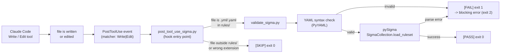

[English](README.md) | Türkçe

# Claude Code PostToolUse Hook ile Sigma Tespit Mühendisliği Prototipi

Claude Code editör iş akışına PostToolUse hook aracılığıyla entegre edilmiş otomatik Sigma kuralı doğrulamasını gösteren bir prototip.

---

## Projeye Genel Bakış

Bu depo, tek bir Sigma kuralı üzerine kurulu kontrollü bir tespit mühendisliği demosu içermektedir: uzak dosya indirme amacıyla `certutil.exe` kötüye kullanımının tespiti. Proje, `rules/` dizini içinde herhangi bir Sigma kuralı yazıldığında veya düzenlendiğinde otomatik olarak doğrulama yapan bir Claude Code PostToolUse hook eklemektedir.

Amaç, yapay zeka destekli kodlama araçlarının manuel müdahale olmaksızın tespit mühendisliği kalite kapılarını (quality gate) nasıl uygulayabileceğini göstermektir.

---

## Problem Tanımı

Yapay zeka destekli bir editörde Sigma kuralı yazan tespit mühendislerinin, sözdizimsel (syntax) olarak bozuk veya yapısal olarak geçersiz YAML'ı commit etmeye karşı yerleşik bir koruma mekanizmaları yoktur. Ayrıştırılamayan (parse edilemeyen) bir kural sessizce commit edilir ve yalnızca bir SIEM veya backend tarafından derlenmeye çalışıldığında hata verir.

Bu prototip, Claude Code'un `rules/` dizinindeki bir dosyayı her yazdığında veya düzenlediğinde otomatik olarak bir doğrulama betiği (script) çalıştırarak bu açığı kapatır.

---

## Bu Prototip Ne Yapar?

- `certutil.exe` URL indirmelerini tespit eden örnek bir Sigma kuralı sağlar (`rules/suspicious_certutil_download.yml`).
- Bir simüle şüpheli olay ve beş zararsız olay içeren örnek bir Sysmon süreç oluşturma olay günlüğü (log) sağlar (`logs/sample_process_events.json`).
- sigma-cli 3.1.0'da henüz uygulanmamış olan `sigma check` komutu yerine **pySigma**'nın (`sigma.collection.SigmaCollection.load_ruleset`) kullanımıyla Sigma kurallarını doğrular.
- Kuralın mantığını örnek günlüğe uygulayan ve beklenen eşleşme sayılarını doğrulayan bir tespit test ortamı (harness) çalıştırır (`scripts/test_detection.py`). **Bu ortam genel amaçlı bir Sigma motoru değildir** -- yalnızca bu prototipte tanımlanan tespit koşulunu test eder.
- Claude Code'un PostToolUse olayına bağlanarak `rules/` içindeki herhangi bir `.yml` veya `.yaml` dosyasını hedef alan her `Write` veya `Edit` aracı çağrısında otomatik olarak doğrulama tetikler.

---

## Mimari ve İş Akışı



**Akış özeti:**

1. Claude Code herhangi bir dosya üzerinde `Write` veya `Edit` çağırır.
2. Dosya diske yazılır veya düzenlenir.
3. `tool_name` değeri `Write` veya `Edit` ile eşleşiyorsa PostToolUse hook tetiklenir.
4. `post_tool_use_sigma.py`, stdin'den gelen hook JSON'ını okur ve hedef dosyanın `rules/` içindeki bir `.yml`/`.yaml` olup olmadığını kontrol eder. Diğer dosyalar exit code 0 ile atlanır.
5. Eşleşen dosyalar için `validate_sigma.py` bir alt süreç (subprocess) olarak çağrılır.
6. `validate_sigma.py` önce PyYAML ile YAML sözdizimini (syntax) kontrol eder, ardından kuralı pySigma'nın `SigmaCollection.load_ruleset` aracılığıyla ayrıştırır.
7. Exit code 0 başarıyı, exit code 2 ise bloklama hatasını bildirir. Claude Code iş akışını durdurur ve doğrulama çıktısını gösterir. Hook yazma işleminden sonra çalıştığından dosya yeni haliyle zaten disktedir; geçerli bir duruma geri döndürmek için sonraki bir `Edit` gerekir.

---

## Depo Yapısı

```
.
|-- .claude/
|   `-- settings.json          # Claude Code hook yapılandırması
|-- evidence/
|   |-- detection-test.txt     # test_detection.py çıktısı (başarılı)
|   |-- hook-failure.txt       # Hook geçersiz kuralı engellediğinde yakalanan çıktı
|   `-- hook-success.txt       # Hook geçerli kuralı kabul ettiğinde yakalanan çıktı
|-- logs/
|   `-- sample_process_events.json  # Altı Sysmon EventID 1 kaydı (bir simüle şüpheli olay)
|-- rules/
|   `-- suspicious_certutil_download.yml  # Test edilen Sigma kuralı
|-- scripts/
|   |-- post_tool_use_sigma.py  # Claude Code PostToolUse hook giriş noktası
|   |-- test_detection.py       # Tespit mantığı test ortamı (prototipin kendisine özgü)
|   `-- validate_sigma.py       # pySigma kullanılarak Sigma/YAML doğrulaması
|-- requirements.txt
`-- README.md
```

---

## Tespit Senaryosu

**Teknik:** `certutil.exe`, `-urlcache` bayrağı aracılığıyla uzak URL'lerden rastgele dosyalar da indirebilen meşru bir Windows sertifika yönetimi aracıdır. Tehdit aktörleri (threat actor), imzalı bir Windows binary olduğu ve uygulama kontrol politikaları (application-control policy) tarafından çoğunlukla güvenilir kabul edildiği için bu aracı yük (payload) indirmek amacıyla kullanır.

**Simüle olay:** Bir domain kullanıcısı (`CORP\jsmith`) şu komutu çalıştırır:

```
certutil.exe -urlcache -split -f https://example.invalid/demo.txt C:\Users\Public\demo.txt
```

Bu komut `logs/sample_process_events.json` dosyasına Sysmon EventID 1 (süreç oluşturma) kaydı olarak işlenir.

---

## Örnek Günlük Formatı

Günlük dosyası JSON formatında altı Sysmon tarzı EventID 1 kaydı içerir. Her kayıt şu alanları içerir:

| Alan               | Açıklama                             |
|--------------------|--------------------------------------|
| `EventID`          | Her zaman 1 (süreç oluşturma)       |
| `UtcTime`          | ISO 8601 zaman damgası              |
| `Computer`         | Hostname (bilgisayar adı)           |
| `User`             | Domain\kullanıcıadı                 |
| `Image`            | Başlatılan yürütülebilir dosyanın tam yolu |
| `CommandLine`      | Tam komut satırı dizisi             |
| `ParentImage`      | Üst sürecin tam yolu                |
| `ParentCommandLine`| Üst sürecin komut satırı            |
| `ProcessId`        | Yeni sürecin PID'i                  |
| `ParentProcessId`  | Üst sürecin PID'i                   |
| `Hashes`           | Dosyanın SHA256 özeti               |

Beş kayıt zararsızdır (Explorer, Notepad, Chrome, cmd, PowerShell). Altıncısı simüle edilmiş şüpheli `certutil.exe` çağrısıdır.

---

## Sigma Kural Mantığı

Dosya: `rules/suspicious_certutil_download.yml`

```yaml
detection:
  selection:
    Image|endswith: '\certutil.exe'
    CommandLine|contains|all:
      - '-urlcache'
      - '-f'
  selection_url:
    CommandLine|contains:
      - 'http://'
      - 'https://'
  condition: selection and selection_url
```

**Koşul analizi:**

- `selection`: Süreç görüntüsünün `\certutil.exe` ile bitmesini **ve** komut satırının hem `-urlcache` hem `-f` içermesini gerektirir.
- `selection_url`: Komut satırının HTTP veya HTTPS URL içermesini gerektirir.
- Her iki koşulun aynı anda sağlanması gerekir (`selection and selection_url`).

`test_detection.py` ortamı bu mantığı Python'da büyük-küçük harf duyarsız (case-insensitive) karşılaştırmalarla uygular ve tam olarak bir olayın eşleştiğini, tam olarak beş olayın eşleşmediğini doğrular.

---

## MITRE ATT&CK Eşlemesi

| Etiket                     | Teknik                           | Gerekçe                                                                                                                           |
|----------------------------|----------------------------------|-----------------------------------------------------------------------------------------------------------------------------------|
| `attack.t1105`             | Ingress Tool Transfer (T1105)    | Kural, `certutil.exe`'nin uzak bir URL'den dosya getirmesi üzerinde tetiklenir -- bu, harici bir kaynaktan ana makineye dosya transferidir. |
| `attack.command-and-control` | Taktik: Command and Control    | T1105, ATT&CK matrisinde C2 taktiği altında yer alır.                                                                            |
| `attack.defense-evasion`   | Taktik: Defense Evasion         | İmzalı bir sistem binary'si (LOLBAS) kullanarak uygulama kontrol politikalarını atlatmak, savunmadan kaçınma (defense evasion) davranışıdır. |

**Neden T1140 (Deobfuscate/Decode Files or Information) kullanılmıyor:**

T1140, kasıtlı olarak kodlanmış içeriğin çözümlenmesini veya gizliliğinin açılmasını kapsar (örneğin, bir Base64 dosyası üzerinde `certutil -decode`). Bu kuraldaki senaryo ise düz HTTPS üzerinden dosya transferidir -- herhangi bir kodlama veya kod çözme gerçekleşmez. T1140 eklemek yanlış bir eşleme olur.

---

## Claude Code PostToolUse Hook

### Yapılandırma

Dosya: `.claude/settings.json`

```json
{
  "hooks": {
    "PostToolUse": [
      {
        "matcher": "Write|Edit",
        "hooks": [
          {
            "type": "command",
            "command": "\"$CLAUDE_PROJECT_DIR/.venv/Scripts/python.exe\" \"$CLAUDE_PROJECT_DIR/scripts/post_tool_use_sigma.py\""
          }
        ]
      }
    ]
  }
}
```

### Davranış

Bu proje, yazma öncesi engelleme yerine **yazma sonrası doğrulama ve bloklama geri bildirimi** (post-write validation with blocking feedback) uygular. `Write` veya `Edit` aracı önce çalışır ve dosya diske kaydedilir. PostToolUse hook ardından tetiklenir ve kaydedilen dosyayı doğrular.

| Koşul                                              | Exit code | Claude Code sonucu       |
|----------------------------------------------------|-----------|--------------------------|
| Araç `Write` veya `Edit` değil                    | 0         | Atlanır, etkisi yoktur   |
| Dosya `.yml` / `.yaml` değil                      | 0         | Atlanır, etkisi yoktur   |
| Dosya `.yml`/`.yaml` ancak `rules/` dışında       | 0         | Atlanır, etkisi yoktur   |
| Dosya `rules/` içinde ve doğrulamayı geçiyor      | 0         | İş akışı normal devam eder |
| Dosya `rules/` içinde ve YAML/Sigma geçersiz      | 2         | **Bloklama hatası** -- iş akışı durur, doğrulama çıktısı gösterilir; dosya zaten yazılmıştır ve sonraki bir Edit ile düzeltilmesi gerekir |

Exit code 2, Claude Code'da hook bloklama hatası için kullanılan standarttır. Alt süreçten gelen exit code 1 ve 2, `post_tool_use_sigma.py` tarafından Claude Code'a döndürülmeden önce exit code 2'ye eşlenir.

---

## Kurulum

Test ortamı: **Windows 11 Pro**, **Python 3.12**, **Claude Code** (en güncel sürüm).

### 1. Depoyu klonlayın

```
git clone <REPOSITORY_URL>
cd claude-code-sigma-automation
```

### 2. Sanal ortam (virtual environment) oluşturun

```
py -m venv .venv
```

### 3. Sanal ortamı etkinleştirin (Windows CMD)

```
.venv\Scripts\activate.bat
```

> PowerShell'de `.venv\Scripts\Activate.ps1` kullanın. macOS/Linux'ta `source .venv/bin/activate` kullanın.

### 4. Bağımlılıkları yükleyin

```
python -m pip install -r requirements.txt
```

Temel paketler:

| Paket        | Sürüm | Amaç                                                          |
|--------------|-------|---------------------------------------------------------------|
| `pySigma`    | 1.5.0 | Sigma kuralı ayrıştırma ve doğrulama                         |
| `sigma-cli`  | 3.1.0 | Yüklendi ancak `sigma check` henüz uygulanmadı               |
| `PyYAML`     | 6.0.3 | YAML sözdizimi (syntax) kontrolü                             |
| `pytest`     | 9.1.1 | İsteğe bağlı: test ortamını pytest runner ile çalıştırın     |

---

## Kullanım

### Claude Code'u başlatın

```
claude
```

PostToolUse hook, Claude Code bu proje dizininde çalışır çalışmaz otomatik olarak etkinleşir. Ek bir yapılandırma gerekmez.

---

## Manuel Sigma Doğrulaması

Tek bir kural dosyasını doğrudan doğrulayın:

```
python scripts\validate_sigma.py rules\suspicious_certutil_download.yml
```

**Beklenen çıktı (geçen kural):**

```
[PASS] YAML syntax valid
[PASS] Sigma rule parsed by pySigma
[PASS] Rule count: 1
[PASS] Sigma validation completed: rules\suspicious_certutil_download.yml
```

Betik (script) başarı durumunda exit code 0 ile çıkar. YAML veya Sigma ayrıştırma hatalarında exit code 1, kullanım hatalarında (yanlış sayıda argüman, yanlış dosya uzantısı) exit code 2 ile çıkar.

**Not:** sigma-cli 3.1.0'ın sağladığı `sigma check` komutu henüz uygulanmamıştır. `validate_sigma.py`, gerçek Sigma yapısı doğrulaması için doğrudan pySigma'nın `SigmaCollection.load_ruleset` metodunu kullanır.

---

## Pozitif ve Negatif Tespit Testleri

Tespit test ortamını çalıştırın:

```
python scripts\test_detection.py
```

**Beklenen çıktı:**

```
[PASS] JSON log file loaded
[PASS] Sigma rule loaded
[PASS] Positive test: 1 suspicious event detected
[PASS] Negative test: 5 benign events ignored
[PASS] All detection tests passed
```

**Ne test ediliyor:**

- **Pozitif test:** Tam olarak bir olay (`certutil.exe -urlcache -split -f https://...` kaydı) kural koşuluyla eşleşir. Test `len(matched) == 1` olduğunu doğrular ve eşleşen görüntünün `\certutil.exe` ile bittiğini kontrol eder.
- **Negatif test:** Kalan beş olay (Explorer, Notepad, Chrome, cmd, PowerShell) eşleşme üretmez. Test `len(benign) == 5` olduğunu doğrular.

**Önemli:** `test_detection.py` genel amaçlı bir Sigma değerlendirme motoru değildir. Yalnızca `suspicious_certutil_download.yml`'deki tespit koşulunu düz Python ile uygular. Başka hiçbir Sigma kuralını doğru şekilde değerlendirmez.

---

## Hook Başarı Testi

Geçen bir hook doğrulamasını gözlemlemek için Claude Code'u kullanarak `rules/suspicious_certutil_download.yml` dosyasında geçerli bir değişiklik yapın (örneğin, `date` alanını güncelleyin). `Edit` aracı dosyayı önce yazar, ardından hook tetiklenir ve `validate_sigma.py`'yi kaydedilen dosyaya karşı çalıştırır.

Başarılı bir hook çalışmasından yakalanan çıktı `evidence/hook-success.txt` dosyasında saklanmaktadır:

```
[PASS] YAML syntax valid
[PASS] Sigma rule parsed by pySigma
[PASS] Rule count: 1
[PASS] Sigma validation completed: rules\suspicious_certutil_download.yml
```

---

## Hook Bloklama Hatası Testi

Bloklayan bir hook hatasını gözlemlemek için Claude Code'u kullanarak kural dosyasına YAML sözdizimi hatası ekleyin -- örneğin, bir anahtardan sonraki iki noktayı kaldırın:

```yaml
# Geçersiz (iki nokta eksik):
author Ekrem Tunckir

# Geçerli:
author: Ekrem Tunckir
```

`Edit` aracı geçersiz içeriği önce diske yazar. Ardından PostToolUse hook tetiklenir ve `validate_sigma.py`'yi kaydedilen dosyaya karşı çalıştırır. `validate_sigma.py` exit code 1 (YAML hatası) ile çıktığından `post_tool_use_sigma.py` exit code 2 ile çıkar; bunu Claude Code bloklama hatası olarak yorumlar.

Bloklayan bir hook çalışmasından yakalanan çıktı `evidence/hook-failure.txt` dosyasında saklanmaktadır:

```
PostToolUse:Edit hook returned blocking error
[FAIL] YAML syntax error: could not find expected ':'
Fault introduced: author Ekrem Tunckir
Fault corrected: author: Ekrem Tunckir
```

Claude Code doğrulama hatasını bloklama hatası olarak gösterir ve iş akışını durdurur. Dosya geçersiz haliyle diskte kalmaya devam eder; geçerli bir duruma geri döndürmek için sonraki bir `Edit` gerekir.

---

## Kanıt Dosyaları

`evidence/` klasöründeki tüm kanıt dosyaları, hedef ortamda (Windows 11, Python 3.12, Claude Code) geliştirme sürecinde yakalanan gerçek terminal çıktılarıdır.

| Dosya                    | İçerik                                                              |
|--------------------------|---------------------------------------------------------------------|
| `detection-test.txt`     | `python scripts\test_detection.py` çıktısı -- tüm testler başarılı |
| `hook-success.txt`       | Geçerli bir Sigma kuralında hook doğrulama çıktısı                 |
| `hook-failure.txt`       | YAML geçersiz bir kuralda hook bloklama hatası çıktısı             |

---

## Beklenen Çıktılar

### `python scripts\validate_sigma.py rules\suspicious_certutil_download.yml`

```
[PASS] YAML syntax valid
[PASS] Sigma rule parsed by pySigma
[PASS] Rule count: 1
[PASS] Sigma validation completed: rules\suspicious_certutil_download.yml
```

### `python scripts\test_detection.py`

```
[PASS] JSON log file loaded
[PASS] Sigma rule loaded
[PASS] Positive test: 1 suspicious event detected
[PASS] Negative test: 5 benign events ignored
[PASS] All detection tests passed
```

### Hook -- geçerli kural

```
[INFO] Validating Sigma rule: rules\suspicious_certutil_download.yml
[PASS] YAML syntax valid
[PASS] Sigma rule parsed by pySigma
[PASS] Rule count: 1
[PASS] Sigma validation completed: rules\suspicious_certutil_download.yml
[PASS] Hook completed successfully for: rules\suspicious_certutil_download.yml
```

### Hook -- geçersiz kural (bloklama hatası)

```
[INFO] Validating Sigma rule: rules\suspicious_certutil_download.yml
[FAIL] YAML syntax error: could not find expected ':'
PostToolUse:Edit hook returned blocking error
```

---

## Sınırlamalar

- **Tek kural kapsamı.** Tespit test ortamı `suspicious_certutil_download.yml` ve `sample_process_events.json` dosyalarına sabit kodlanmıştır (hardcoded). Genelleştirilemez.
- **Sigma backend yok.** `validate_sigma.py`, kuralın doğru ayrıştırıldığını onaylar. Kuralı herhangi bir SIEM sorgu diline (Splunk SPL, KQL, Elasticsearch DSL, vb.) derlemez.
- **sigma check kullanılamıyor.** sigma-cli 3.1.0, `sigma check` komutunu uygulamamaktadır. `sigma-cli` paketi ekosisteme bağımlılık olduğundan `requirements.txt`'e dahil edilmiştir; ancak doğrulama tamamen pySigma'ya dayanmaktadır.
- **Alan eşlemesi (field mapping) yok.** Test ortamı, ham JSON alan adlarını örnek günlükten eşleştirir. Gerçek Sigma backend'leri alan eşlemeleri uygular (örneğin, `Image` -> `process.executable`). Burada eşleme katmanı bulunmamaktadır.
- **Windows'a özgü hook yolu.** `.claude/settings.json`'daki hook komutu `.venv\Scripts\python.exe` kullanır (Windows). macOS/Linux'ta yol `.venv/bin/python` olacaktır.
- **CI entegrasyonu yok.** Doğrulama yalnızca Claude Code içinde yerel olarak çalışır. GitHub Actions iş akışı veya pre-commit hook bulunmamaktadır.
- **Yalnızca yazma sonrası doğrulama.** Hook, dosya yazıldıktan sonra doğrulama yapar. Geçersiz bir yazma, Claude Code düzeltici bir düzenleme uygulayana kadar dosyayı bozuk halde bırakır.

---

## Gelecekteki İyileştirmeler

- Doğrulanmış kuralların hedef sorgu diline derlenebilmesi için bir `pySigma` backend ekleyin (örneğin, `pySigma-backend-splunk`).
- `test_detection.py`'yi, koşul mantığını sabit kodlamak yerine kural YAML'ından okuyan genel amaçlı bir ortama dönüştürün.
- `rules/` altındaki her aşamalı (staged) `.yml` dosyasında `validate_sigma.py` çalıştıran bir pre-commit hook ekleyin (`pre-commit` aracılığıyla).
- Push ve pull request işlemlerinde tüm kuralları doğrulayan GitHub Actions CI ekleyin.
- Daha fazla LOLBAS tekniğini kapsayacak şekilde örnek günlüğü genişletin ve karşılık gelen kurallar ekleyin.
- Test ortamının Sigma alan adlarını günlük şemasına otomatik olarak çevirebilmesi için alan eşlemesi (field mapping) desteği ekleyin.

---

## Güvenlik ve Etik Kullanım Notu

Bu depo, eğitim ve araştırma amaçlı bir tespit mühendisliği prototipidir. Sigma kuralı ve örnek günlük, bilinen bir saldırgan tekniğini (`certutil.exe` dosya indirme) kontrollü, çevrimdışı bir bağlamda simüle eder. Gerçek kötü amaçlı yazılım (malware), shellcode veya aktif yük (payload) içermez.

- Örnek günlük, çözümlenemeyen ve gerçek ağ istekleri yapılamayan `https://example.invalid/` domainini kullanır.
- Tüm simüle şüpheli olaylar, yürütülebilir içeriği olmayan sentetik günlük girdileridir.
- Tüm tespit içeriği, MITRE ATT&CK çerçevesi ve LOLBAS projesinde kamuya açık olarak belgelenmiş tekniklerden yararlanmaktadır.

Bu depodaki tespit kurallarını, özel günlük şemanız ve ortamınıza göre inceleme, ince ayar (tuning) ve doğrulama yapmadan üretim ortamında kullanmayın.

---

## Öğrenilen Dersler

- **`sigma check` sigma-cli 3.1.0'da kullanılamıyor.** Komut belgelerinde mevcuttur ancak çalışma zamanında `NotImplementedError` fırlatır. Programatik doğrulama için doğru yaklaşım, pySigma'nın `SigmaCollection.load_ruleset` metodunu doğrudan kullanmaktır.
- **PostToolUse exit code 2 bloklama sinyalidir.** Claude Code, exit code 0'ı (geçti/atlandı) exit code 2'den (bloklama hatası) ayırt eder. Alt süreçten gelen exit code 1, hook'tan döndürülmeden önce 2'ye yeniden eşlenmelidir.
- **PostToolUse yazma sonrasıdır, yazma öncesi değil.** Hook, dosya zaten kaydedildikten sonra tetiklenir. Geçersiz bir yazma, dosyayı bozuk halde bırakır; bloklama hatası Claude Code'un durmasına ve hatayı raporlamasına neden olur, ancak yine de düzeltici bir düzenleme gerekmektedir.
- **Hook kapsam korumaları önemlidir.** `rules/` dizin kontrolü ve `.yml`/`.yaml` uzantı kontrolü olmadan, hook Claude Code'un dokunduğu her dosyayı doğrulamaya çalışırdı -- Python betikleri, JSON dosyaları ve README güncellemeleri dahil -- bu da gereksiz hatalara yol açardı.
- **T1140 çoğunlukla gereğinden fazla uygulanıyor.** `certutil -decode` (Base64 çözme) T1140'a eşlenir, ancak `certutil -urlcache -f` (uzaktan indirme) T1105'e eşlenir. Yalnızca indirme içeren bir kurala her ikisini de uygulamak eşleme hatası olur.

---

## Lisans

Bu proje [MIT Lisansı](LICENSE) altında yayınlanmaktadır.

Telif hakkı (c) 2026 Ekrem Tunckir. Bu yazılımı MIT Lisansı koşulları çerçevesinde kullanmak, kopyalamak, değiştirmek, birleştirmek, yayınlamak, dağıtmak, alt lisans vermek ve/veya satmak serbesttir. Lisansın tam metni için [LICENSE](LICENSE) dosyasına bakın.
