# SOC Detection Engineering | Splunk SIEM ile SSH Failed Login Detection

> **Gerçek laboratuvar kanıtlarıyla belgelenmiş vaka analizi.** Parrot OS üzerinde Splunk Enterprise; Cisco Linux, Kali Linux ve Fedora Linux üzerinde Universal Forwarder; Linux SSH loglarından SPL ile detection; Scheduled Alert ve otomatik tetiklenme doğrulaması.

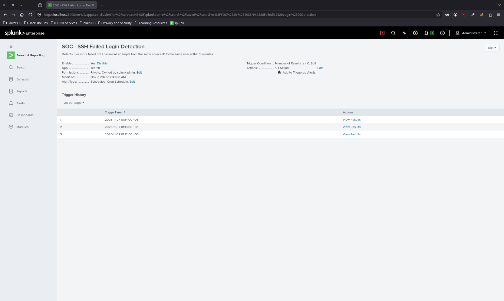

<p align="center"><strong>Durum:</strong> Log collection ✅ &nbsp;|&nbsp; Field extraction ✅ &nbsp;|&nbsp; Detection threshold ✅ &nbsp;|&nbsp; Scheduled alert ✅ &nbsp;|&nbsp; Trigger history ✅</p>

## İçindekiler

1. [Executive summary](#1-executive-summary)
2. [Mimari ve kapsam](#2-mimari-ve-kapsam)
3. [Kurulum: Parrot / Splunk Enterprise](#3-kurulum-parrot--splunk-enterprise)
4. [Index oluşturma](#4-index-oluşturma)
5. [Universal Forwarder ve endpoint yapılandırmaları](#5-universal-forwarder-ve-endpoint-yapılandırmaları)
6. [Merkezî log toplama doğrulaması](#6-merkezî-log-toplama-doğrulaması)
7. [Kontrollü SSH testi ve SPL parsing](#7-kontrollü-ssh-testi-ve-spl-parsing)
8. [Detection mantığı ve zaman penceresi](#8-detection-mantığı-ve-zaman-penceresi)
9. [Scheduled Alert ve gerçek tetiklenme](#9-scheduled-alert-ve-gerçek-tetiklenme)
10. [Yanlış pozitif / yanlış negatif analizi](#10-yanlış-pozitif--yanlış-negatif-analizi)
11. [MITRE ATT&CK eşlemesi](#11-mitre-attck-eşlemesi)
12. [Troubleshooting, kanıt listesi ve sonraki adımlar](#12-troubleshooting-kanıt-listesi-ve-sonraki-adımlar)

---

## 1. Executive summary

Bu vaka çalışmasında izole VMware laboratuvarı üzerinde üç Linux makinesinden Splunk Enterprise'a güvenlik günlükleri aktarıldı. Ardından SSH parola hataları (`Failed password`) için kaynak IP (`src_ip`), hedef kullanıcı (`target_user`) ve başarısız giriş sayısını çıkaran SPL sorguları geliştirildi. Aynı hedef host + kaynak IP + kullanıcı için **son 5 tamamlanmış dakikada en az 5 başarısız SSH parola girişi** koşuluna dayanan Scheduled Alert yapılandırıldı.

**Doğrulanmış gözlemler:**

| Kanıt | Değer | Yorum |
|---|---:|---|
| Birleşik log araması | **2.207 event** | 3 index, 3 host, 5 log kaynağı; tek bir `All time` anlık görüntüsü |
| İlk failed-SSH parsing | **1 event** | `10.44.0.101 → cisco` ayrıştırması çalıştı |
| Daha sonraki birikimli SSH olayları | **15 event** | Cisco IP'sinden 9, Kali IP'sinden 6; **All time**, 5 dk kanıtı değil |
| Bir geçmiş 5 dk pencere kontrolü | **maksimum 4** | Kali kaynaklı 6 olayın tamamı aynı pencereye girmedi |
| Son kontrol | **5 event / 5 dk** | Kali `10.44.0.101`, hedef `labvm`, kullanıcı `cisco` |
| Otomatik alarm geçmişi | **3 trigger** | 01:12, 01:13 ve 01:14 (+03), 7 Kasım 2026 |

**Sonuç:** SPL tespiti ve otomatik zamanlanmış alarm **başarılı olarak doğrulandı**. Üç tetiklenme **üç ayrı saldırı** demek değildir; arama pencereleri örtüşebilir.

> **Kanıt disiplini:** Aşağıdaki “gözlendi/doğrulandı” ifadeleri sohbet boyunca paylaşılan terminal çıktıları veya ekran görüntülerine dayanır. Bazı `tar`, `btool` ve örnek `.conf` komutları ise laboratuvarı **yeniden oluşturma yönergesidir**; her satırın bire bir çalıştırıldığına ilişkin ayrı ekran görüntüsü yoktur. Uygulanmamış tuning/hardening işlemleri açıkça belirtilmiştir.

## 2. Mimari ve kapsam

### 2.1 Network topology

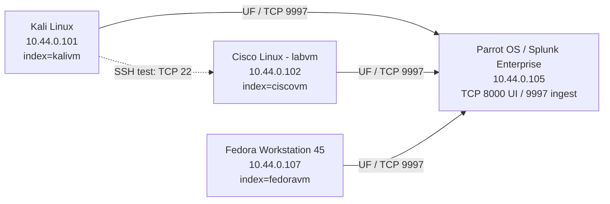

| Sistem | IP | Rol | Log kaynakları |
|---|---|---|---|
| Parrot OS | `10.44.0.105` | Splunk Enterprise 10.6.1.1 | Central SIEM / Search Head / Indexer |
| Cisco Linux (`labvm`) | `10.44.0.102` | SSH hedefi; Universal Forwarder | `/var/log/auth.log`, `/var/log/syslog` |
| Kali Linux | `10.44.0.101` | Yetkili test istemcisi; Universal Forwarder | `/var/log/auth.log`, `/var/log/syslog` |
| Fedora Workstation 45 (`fedora-soc`) | `10.44.0.107` | Universal Forwarder | `/var/log/secure` |

- İletim kanalı: Universal Forwarder → Splunk, **TCP/9997**.
- Splunk Web: **TCP/8000**; management API: **TCP/8089**.
- SSH test hedefi: Cisco Linux `10.44.0.102:22`.
- Bu laboratuvar IP'leri özel ağ adresleridir; üretim ortamı hedefleri değildir.

### 2.2 Teknolojiler

`Splunk Enterprise 10.6.1.1` · `Splunk Universal Forwarder 10.6.1.1` · `VMware Workstation` · `Linux` · `rsyslog` · `SSH/OpenSSH` · `SPL` · `POSIX ACL`.

## 3. Kurulum: Parrot / Splunk Enterprise

### 3.1 Parrot makinesini doğrulama

```bash
ip -4 -br addr
```

**Gözlenen:** `ens33 UP 10.44.0.105/24`.

### 3.2 Splunk Enterprise arşivini yükleme

Linux AMD64 arşivi kullanıldı: `splunk-10.6.1.1-b2ae2962645c-linux-amd64.tgz`. Yeniden uygulama örneği:

```bash
cd ~/Downloads/splunk
file splunk-10.6.1.1-b2ae2962645c-linux-amd64.tgz
# Üreticinin resmi checksum değeriyle ayrıca karşılaştırılmalı.
sudo tar -xzf splunk-10.6.1.1-b2ae2962645c-linux-amd64.tgz -C /opt
ls -ld /opt/splunk
```

**Not:** Önceki kurulum sürecine ait terminal çıktıları Splunk'ın kritik dizinleri oluşturduğunu ve paket manifest bütünlüğü kontrolünü geçtiğini gösteriyor. Bağımsız checksum karşılaştırması kanıtlanmış değildir.

### 3.3 Splunk servisini başlatma ve kontrol

Laboratuvarda kullanılmış komut:

```bash
sudo /opt/splunk/bin/splunk start --run-as-root --accept-license
sudo /opt/splunk/bin/splunk status --run-as-root
```

**Gözlenen çıktılar:** `All preliminary checks passed`, `splunkd is running`, web sunucusu `http://127.0.0.1:8000` kullanılabilir.

> **Güvenlik:** `--run-as-root` laboratuvarda kullanıldı; üretimde least privilege yaklaşımıyla ayrı servis hesabı, uygun dizin sahipliği ve TLS yapılandırması gerekir. İşletim sistemi güvenlik duvarını sınırsız açmayın.

### 3.4 TCP/9997 Receiving etkinleştirme

Splunk Web: **Settings → Forwarding and receiving → Configure receiving → New Receiving Port**.

Gelen veri portu: `9997`.

```bash
sudo ss -lntp | grep ':9997'
```

**Gözlenen:** `splunkd` `0.0.0.0:9997` üzerinde `LISTEN` durumundaydı.

Aşağıdaki görüntü, ilk denemede **yanlış menüye** (`Forward data`) sadece `9997` girildiğinde çıkan hatadır. Orada `host:port` beklenir; **receiving** ekranıyla karıştırılmamalıdır.

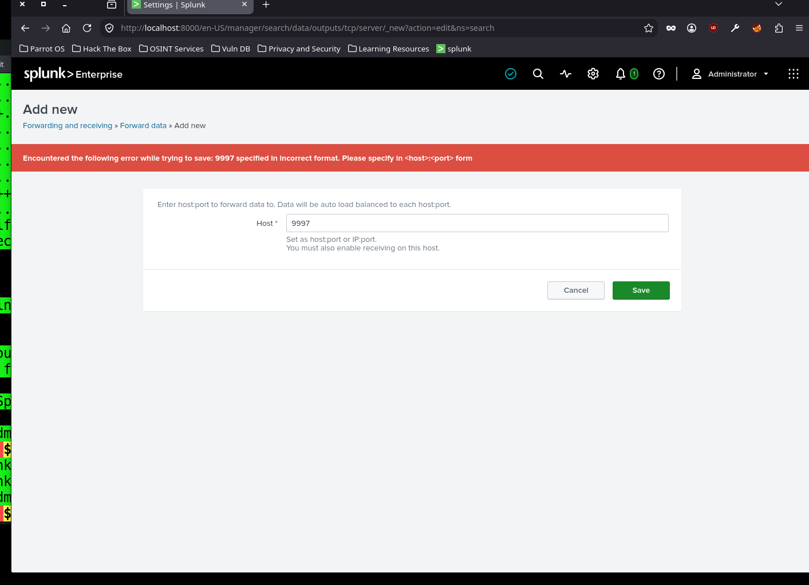

*Kanıt 01 — Forward data/Receiving farkı: ilk hata ve doğru menünün neden önemli olduğu.*

## 4. Index oluşturma

Splunk Web → **Settings → Indexes → New Index**. Üç ayrı index oluşturuldu:

| Index | Host | Gözlenen durum |
|---|---|---|
| `ciscovm` | labvm | Active |
| `kalivm` | kali | Active |
| `fedoravm` | fedora-soc | Active |

| Cisco index | Kali index | Fedora index |
|---|---|---|
| 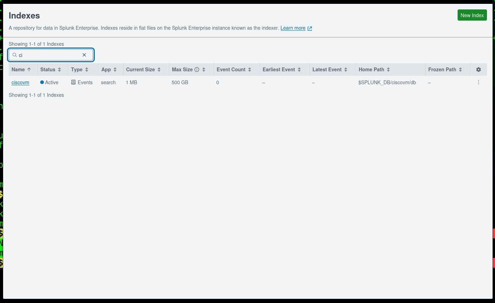 | 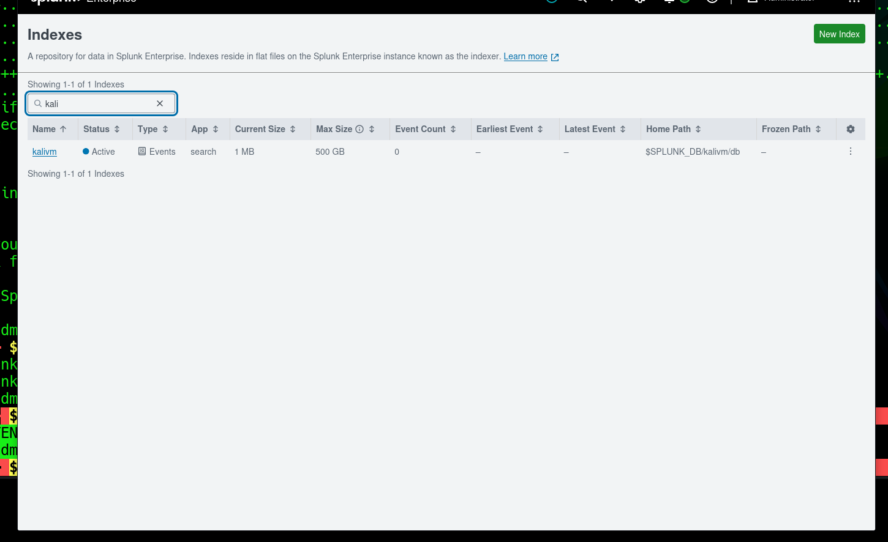 | 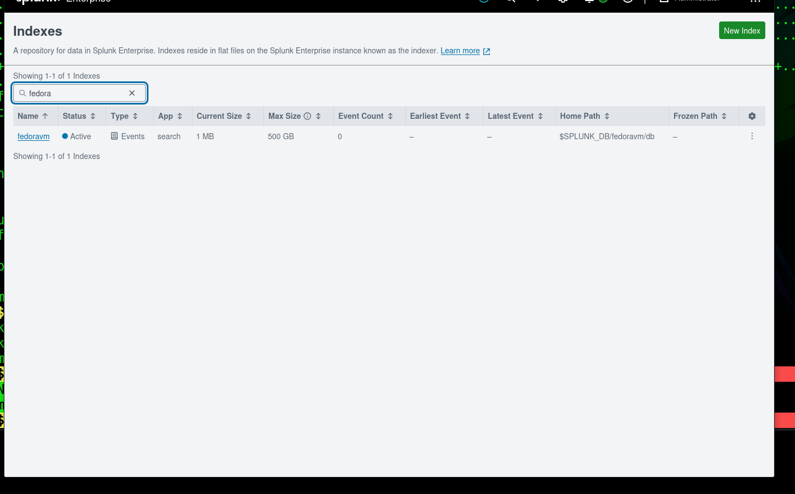 |

*Kanıt 02–04 — Üç ayrı Splunk index oluşturuldu.*

## 5. Universal Forwarder ve endpoint yapılandırmaları

### 5.1 Linux Universal Forwarder kurulumu

Paket: `splunkforwarder-10.6.1.1-b2ae2962645c-linux-amd64.tgz` (Windows `.msi` değil).

```bash
sudo tar -xzf splunkforwarder-10.6.1.1-b2ae2962645c-linux-amd64.tgz -C /opt
sudo /opt/splunkforwarder/bin/splunk version
sudo /opt/splunkforwarder/bin/splunk status --run-as-root
```

Cisco/Fedora/Kali üzerinde **Splunk Universal Forwarder 10.6.1.1** çalıştığı doğrulandı. Servis hesabı için ayrıca:

```bash
ps -o user,group,pid,args -C splunkd
systemctl list-unit-files | grep -i splunk
```

Kali ve Fedora üzerinde daemon'ın sırasıyla `kali` ve `admin` kullanıcıları altında çalıştığı görüldü. Gerçek servis hesabı, `sudo` ile yapılan çağrıdan bağımsız olarak kontrol edilmelidir.

### 5.2 outputs.conf — hedef Splunk sunucusu

**Fedora'da uygulanan etkin ayar** (`/opt/splunkforwarder/etc/system/local/outputs.conf`):

```ini
[tcpout]
defaultGroup = fedora_group

[tcpout:fedora_group]
server = 10.44.0.105:9997
```

Cisco ve Kali endpoint'lerinde `default-autolb-group` ile aynı hedef sunucu kullanıldığı gözlendi. Yeniden kullanım için temiz örnekler `configs/` altındadır.

```bash
sudo /opt/splunkforwarder/bin/splunk btool outputs list --debug
sudo ss -tnp | grep '10.44.0.105:9997'
```

**Gözlenen:** Cisco ve Kali'de `ESTAB` bağlantısı. `nc -vz 10.44.0.105 9997` ağ testleri başarılı. Bağlantı kurulması tek başına logların indekslendiği anlamına gelmez; indeks ve test mesajı ile doğrulama ayrıca yapıldı.

### 5.3 inputs.conf — monitor edilen dosyalar

Cisco için etkin yapılandırmada `ciscovm`, Kali için `kalivm` index değerleri görüldü. Örnek:

```ini
[monitor:///var/log/auth.log]
disabled = false
index = ciscovm

[monitor:///var/log/syslog]
disabled = false
index = ciscovm
```

Kali tarafında iki stanza için de `index = kalivm` olmalıdır. `/var/log/syslog` stanza'sı ilk etapta `index=default` olarak görünmüş, düzeltildikten sonra `kalivm` kaynağından syslog logları doğrulanmıştır.

**Fedora** (`/opt/splunkforwarder/etc/system/local/inputs.conf`):

```ini
[monitor:///var/log/secure]
disabled = false
index = fedoravm
sourcetype = linux_secure
```

```bash
sudo /opt/splunkforwarder/bin/splunk btool inputs list --debug
```

### 5.4 Fedora kurulumu ve dosya izinleri

VMware üzerinde Fedora 45 **Workstation Edition** kuruldu (önceki Fedora Server kurulum girişimi nihai ortam değildir). Son durumu `fedora-soc`, `10.44.0.107/24` olarak gözlendi.

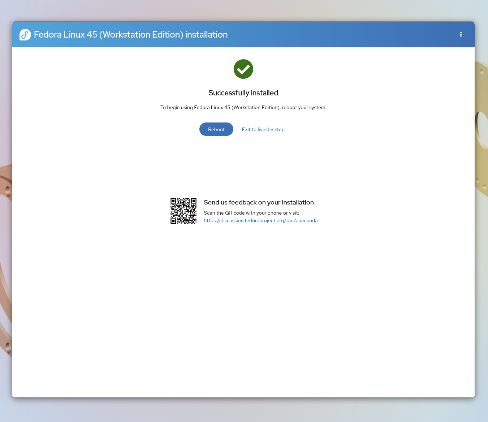

*Kanıt 05 — VMware Fedora Workstation 45 kurulumu tamamlandı.*

Fedora'da `rsyslog` aktifti ve `/var/log/secure` log dosyası vardı. Ancak Forwarder `admin` kullanıcısı üzerinden çalışırken `root:root` sahipliğindeki `0600` dosyasına erişemedi:

```bash
sudo -u admin test -r /var/log/secure && echo "READ OK" || echo "ACCESS DENIED"
# İlk sonuç: ACCESS DENIED
sudo setfacl -m u:admin:r /var/log/secure
sudo getfacl /var/log/secure
# user:admin:r--
sudo -u admin test -r /var/log/secure && echo "READ OK" || echo "ACCESS DENIED"
# Sonuç: READ OK
```

**Önemli:** Dosya sahibi değiştirilmedi; yalnızca okuma ACL'si eklendi. Üretimde dedicated service account ve logrotate / SELinux etkileri ayrıca tasarlanmalıdır. Bir güvenlik log dosyasına `chmod 777` vermek doğru değildir.

## 6. Merkezî log toplama doğrulaması

### 6.1 Endpoint bazında veri geldi mi?

| Cisco endpoint | Kali endpoint |
|---|---|
| 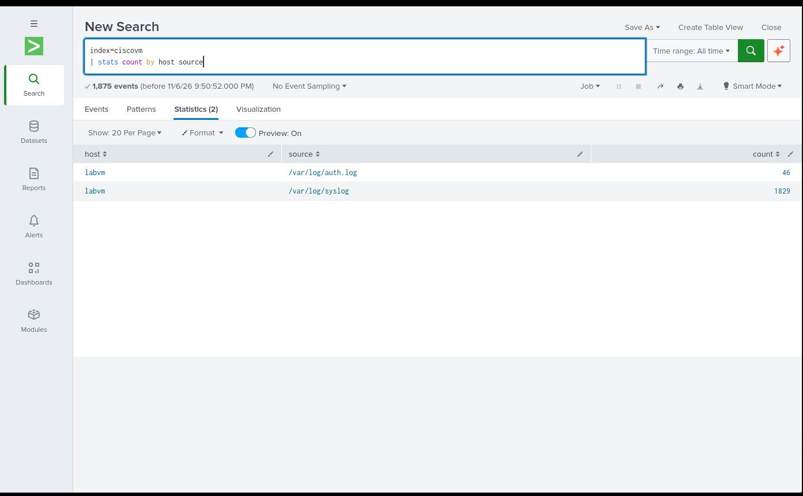 | 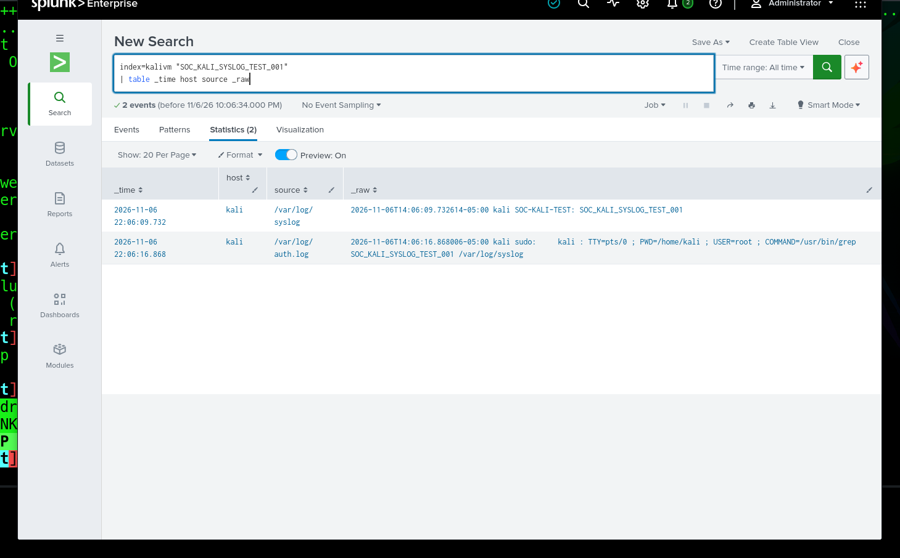 |

*Kanıt 06 ve 08 — Cisco ve Kali logları kendi indekslerinde görünüyor.*

Cisco tarafında `logger` ile oluşturulan `SOC_CISCO_AUTH_TEST_001` mesajı `auth.log` kaynağıyla Splunk'ta görüldü.

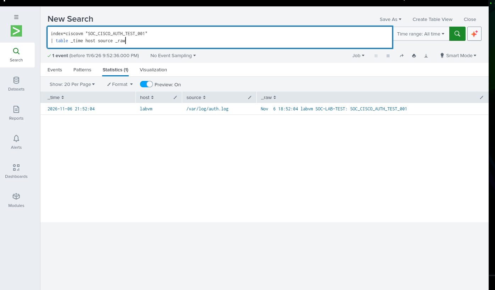

*Kanıt 07 — Cisco endpoint için uçtan uca test mesajı.*

Fedora üzerinde:

```bash
logger -p authpriv.notice -t SOC-FEDORA-TEST "SOC_FEDORA_AUTH_TEST_001"
sudo grep 'SOC_FEDORA_AUTH_TEST_001' /var/log/secure
```

Splunk'ta:

```spl
index=fedoravm "SOC_FEDORA_AUTH_TEST_001"
| table _time host source sourcetype _raw
```

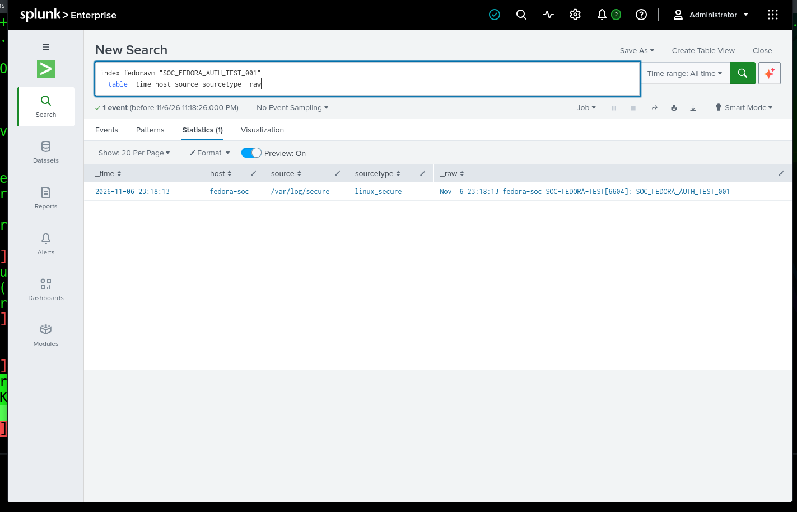

*Kanıt 09 — Fedora `linux_secure` test mesajı indekste bulundu.*

### 6.2 Tüm hostları tek aramada karşılaştırma

```spl
(index=ciscovm OR index=kalivm OR index=fedoravm)
| stats count by index host source
| sort index source
```

| Index | Host | Source | Event count |
|---|---|---|---:|
| `ciscovm` | `labvm` | `/var/log/auth.log` | 53 |
| `ciscovm` | `labvm` | `/var/log/syslog` | 1.855 |
| `kalivm` | `kali` | `/var/log/auth.log` | 102 |
| `kalivm` | `kali` | `/var/log/syslog` | 87 |
| `fedoravm` | `fedora-soc` | `/var/log/secure` | 110 |
| **Toplam** | | | **2.207** |

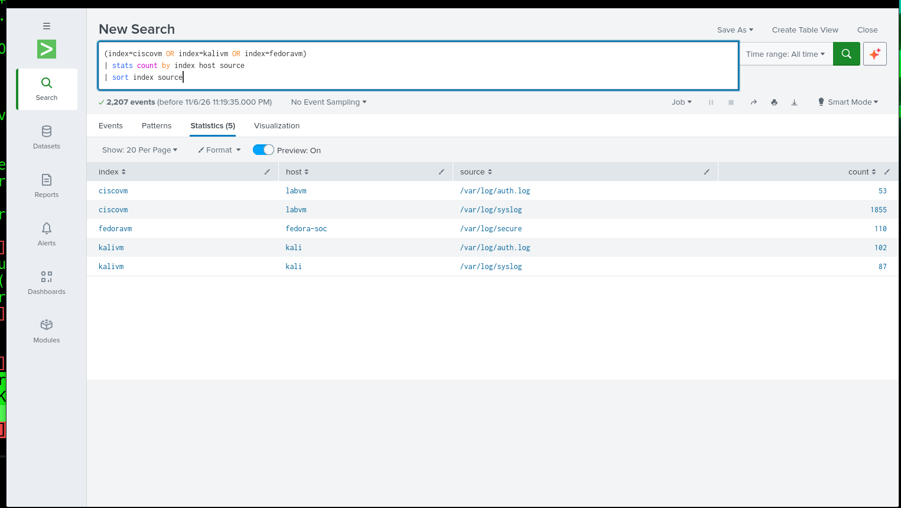

*Kanıt 10 — Üç host, beş kaynak, 2.207 event; sayılar bir arama anına aittir.*

## 7. Kontrollü SSH testi ve SPL parsing

### 7.1 Test senaryosu

- **Authorized test client:** Kali Linux `10.44.0.101`
- **SSH target:** Cisco Linux `10.44.0.102`, kullanıcı `cisco`
- **Amaç:** Başarısız parola girişinin loga yazılması ve Splunk'ta görünmesi.

```bash
# Yalnızca izole, yetki verilmiş laboratuvarda
ssh -o PreferredAuthentications=password \
    -o PubkeyAuthentication=no \
    -o NumberOfPasswordPrompts=1 \
    cisco@10.44.0.102
```

Bir yanlış parola girildi; terminal `Permission denied (publickey,password)` döndürdü. Kali hostname/IP ayrıca doğrulandı; ilk denemelerin bir kısmının yanlışlıkla Cisco makinesinin kendisinden yapılmış olması, kaynak IP analizini gerekli kıldı.

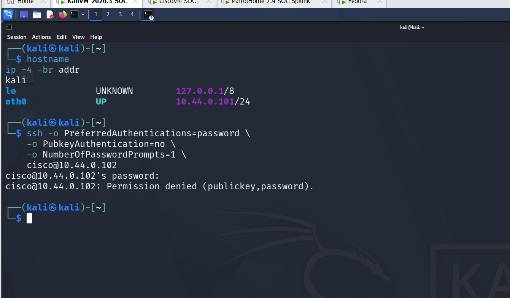

*Kanıt 13 — Testin Kali `10.44.0.101` üzerinden yapıldığı terminal çıktısı.*

### 7.2 Ham SSH olayları

```spl
index=ciscovm source="/var/log/auth.log"
("Failed password" OR "authentication failure" OR "Invalid user")
| table _time host source _raw
| sort - _time
```

İlk doğrulamada `Failed password for cisco from 10.44.0.101` ve aynı bağlantıyla ilişkili PAM `authentication failure` mesajı bulundu.

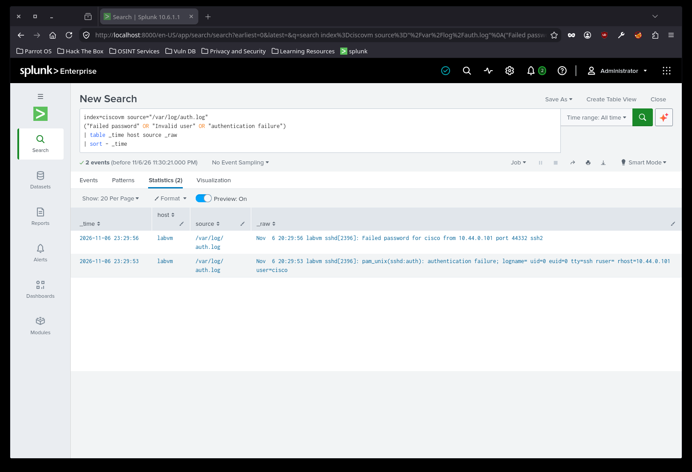

*Kanıt 11 — SSHD `Failed password` ve PAM authentication failure logları.*

**Analitik ayrım:** Bir kimlik doğrulama girişimi iki farklı log satırına karşılık gelebilir. İkisini aynı sayaçta toplamak hatalı eşik hesaplamasına yol açabilir. Bu yüzden bu kullanım senaryosunda yalnızca `Failed password` logları sayıldı.

### 7.3 SPL ile alan çıkarımı

```spl
index=ciscovm source="/var/log/auth.log" "Failed password"
| rex field=_raw "Failed password for (?:invalid user )?(?<target_user>\S+) from (?<src_ip>\d{1,3}(?:\.\d{1,3}){3}) port (?<src_port>\d+)"
| where isnotnull(src_ip) AND isnotnull(target_user)
| stats count AS failed_attempts by host src_ip target_user
| sort - failed_attempts
```

| Alan | Anlamı |
|---|---|
| `host` | Logu gönderen hedef Linux makine |
| `src_ip` | SSH giriş denemesini başlatan IP |
| `target_user` | Kullanıcı adı |
| `src_port` | İstemci kaynak portu (regex ile çıkarılır) |
| `failed_attempts` | Gruplanmış başarısız parola olayları |

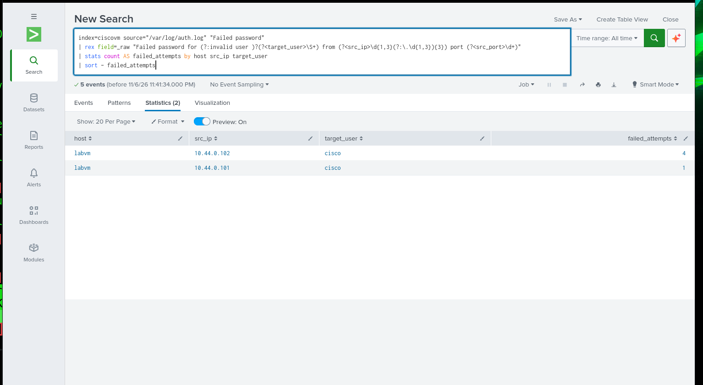

*Kanıt 12 — `host=labvm`, `src_ip=10.44.0.101`, `target_user=cisco`, `failed_attempts=1`.*

## 8. Detection mantığı ve zaman penceresi

### 8.1 Detection rule

**Use case:** `SOC-SSH-001`, Possible SSH Password Guessing.
**Mantık:** Aynı `host + src_ip + target_user` kombinasyonunda **son 5 tamamlanmış dakikada 5 veya daha fazla `Failed password` olayı**.

Bu bir **heuristic detection**: başarısız giriş yoğunluğunu algılar; tek başına kötü niyetli brute-force saldırısının kesin kanıtı değildir.

### 8.2 “All time = 5 dakika” hatası

İlk testlerde 5 olayın 4'ü `10.44.0.102` ve 1'i `10.44.0.101` kaynaklıydı. Sonraki toplam birikim `10.44.0.102 → 9`, `10.44.0.101 → 6` olarak görüldü; fakat bu **All time** sayıları bir 5 dk penceresini ispatlamaz.

Geçmiş olaylarda hareketli pencereyi ölçen ayrı sorgu:

```spl
index=ciscovm source="/var/log/auth.log" "Failed password"
| rex field=_raw "Failed password for (?:invalid user )?(?<target_user>\S+) from (?<src_ip>\d{1,3}(?:\.\d{1,3}){3}) port (?<src_port>\d+)"
| where src_ip="10.44.0.101"
| sort 0 _time
| streamstats time_window=5m count AS attempts_5m by host src_ip target_user
| table _time host src_ip target_user attempts_5m
| sort - _time
```

**Gözlem:** Altı olayın geçmiş kontrolünde maksimum `attempts_5m=4` idi. `streamstats time_window` komutu sıralı zaman girdisi gerektirir; bu nedenle `sort 0 _time` zorunlu hâle geldi.

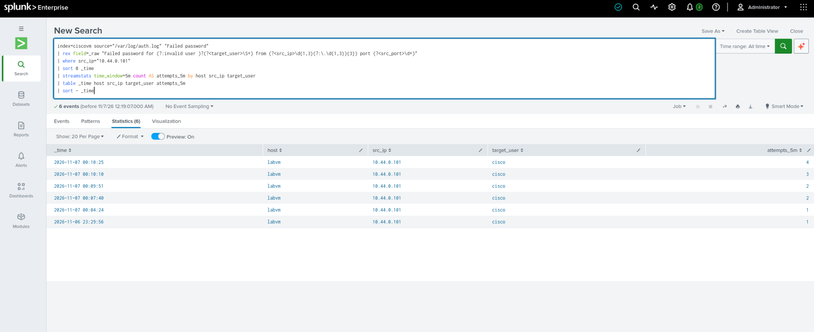

*Kanıt 14 — Kali için hareketli pencere sayımı 1,1,2,2,3,4; eşik henüz yok.*

### 8.3 Zamanlanmış alarm için **nihai SPL**

Sorgu ayrı dosyada: [`spl/06-scheduled-ssh-detection.spl`](spl/06-scheduled-ssh-detection.spl).

```spl
index=ciscovm source="/var/log/auth.log" "Failed password"
| rex field=_raw "Failed password for (?:invalid user )?(?<target_user>\S+) from (?<src_ip>\d{1,3}(?:\.\d{1,3}){3}) port (?<src_port>\d+)"
| where isnotnull(src_ip) AND isnotnull(target_user)
| stats count AS failed_attempts min(_time) AS first_seen max(_time) AS last_seen by host src_ip target_user
| where failed_attempts >= 5
| convert ctime(first_seen) ctime(last_seen)
| sort - failed_attempts
```

**Dikkat:** Bu sorguda 5 dakika sınırını SPL içinde belirlemiyoruz; Scheduled Alert'in **Time Range** ayarı uygular. `All time` ile elle çalıştırılırsa tarih boyunca sayar. Alert olarak doğru çalışması için hem sorgu hem zaman aralığı birlikte gerekli.

## 9. Scheduled Alert ve gerçek tetiklenme

### 9.1 Alert oluşturma

Splunk Web → **Search & Reporting → Save As → Alert**.

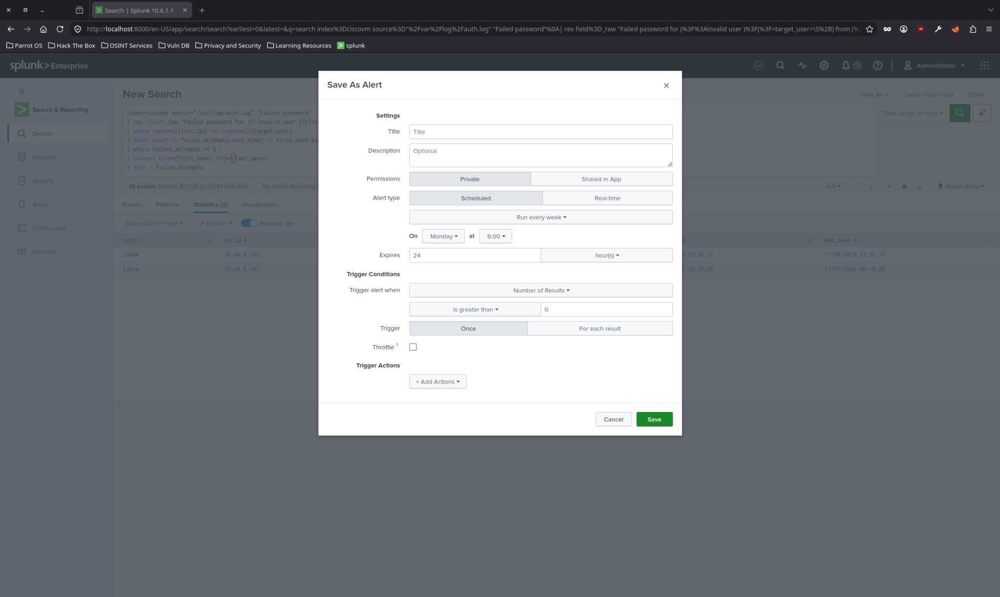

*Kanıt 15 — Scheduled Alert penceresi.*

| Parametre | Değer |
|---|---|
| Alert Name | `SOC - SSH Failed Login Detection` |
| Type | `Scheduled` |
| Schedule | `Run on Cron Schedule` |
| Cron | `* * * * *` |
| Earliest | `-5m@m` |
| Latest | `@m` |
| Trigger when | `Number of Results > 0` |
| Trigger | `Once` |
| Action | `Add to Triggered Alerts` |
| Permissions | `Private` |
| Expires | `24 hours` (tetikleme kaydının görünürlük ömrü) |

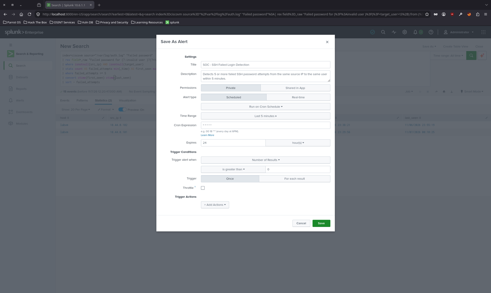

*Kanıt 16 — Time Range “Last 5 minutes” ve Cron ayarları.*

```text
Cron:      * * * * *       # Her dakika
Earliest:  -5m@m           # Son 5 tamamlanmış dakikanın başlangıcı
Latest:    @m              # Güncel dakikanın başlangıcı
```

**Neden `> 0`?** `where failed_attempts >= 5` koşulunu sağlayan grup varsa SPL **en az bir sonuç satırı** üretir. Trigger ayarı sonuç satırı sayısını değerlendirir.

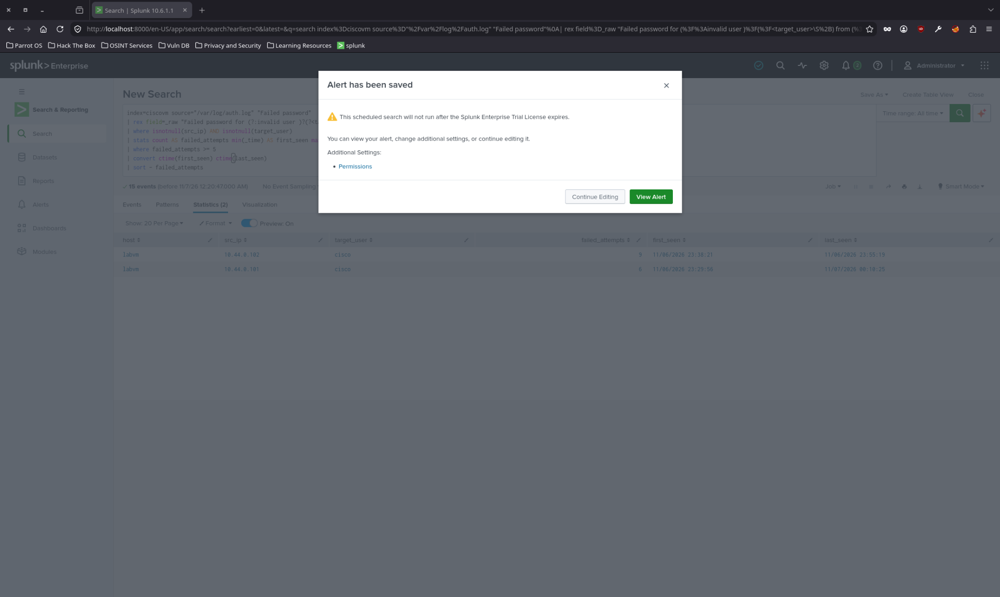

*Kanıt 17 — “Alert has been saved” doğrulaması; trial lisansı süresine ilişkin uyarı da var.*

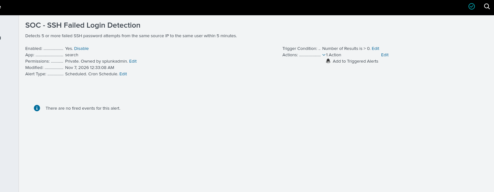

*Kanıt 18 — `Enabled: Yes`, `Add to Triggered Alerts`, henüz ilk anda fired event yok.*

### 9.2 Scheduler doğrulama

```spl
index=_internal sourcetype=scheduler
savedsearch_name="SOC - SSH Failed Login Detection"
| table _time savedsearch_name status result_count fired alert_actions reason
| sort - _time
```

**Gözlem:** 12 ayrı zamanlanmış çalışma `status=success`, `result_count=0` olarak görüldü. Başlangıçta **hata yoktu**, fakat arama penceresinde eşik karşılanmıyordu.

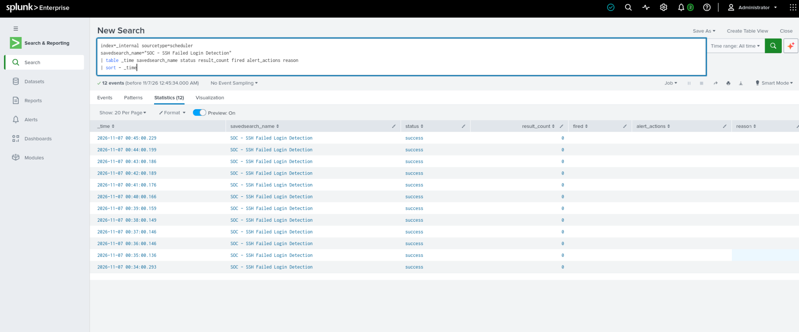

*Kanıt 19 — Scheduled search her dakika başarılı yürütülüyor; o anda sonuç sayısı 0.*

### 9.3 5 dakikada 5 olay — final test

```spl
index=ciscovm source="/var/log/auth.log" "Failed password" earliest=-5m@m latest=@m
| rex field=_raw "Failed password for (?:invalid user )?(?<target_user>\S+) from (?<src_ip>\d{1,3}(?:\.\d{1,3}){3}) port (?<src_port>\d+)"
| where src_ip="10.44.0.101"
| stats count AS failed_attempts by host src_ip target_user
```

**Gözlenen:** `host=labvm`, `src_ip=10.44.0.101`, `target_user=cisco`, `failed_attempts=5`.

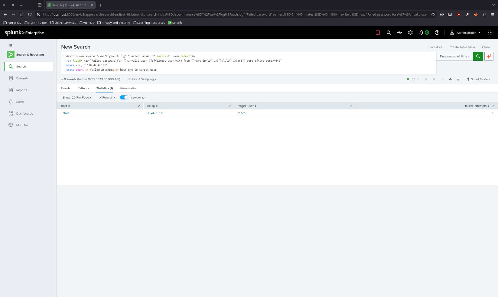

*Kanıt 20 — 5 tamamlanmış dakikalık pencerede 5 olay doğrulandı.*

### 9.4 Otomatik alarm tetiklenmesi (sonuç)

**Alerts → SOC - SSH Failed Login Detection → Trigger History** ekranında **üç tetikleme** doğrulandı:

| Zaman (ekranda +03) | Sonuç |
|---|---|
| 2026-11-07 01:12:00 | Triggered |
| 2026-11-07 01:13:00 | Triggered |
| 2026-11-07 01:14:00 | Triggered |


*Kanıt 21 — Scheduled Alert gerçekten tetiklenmiş: üç Trigger History kaydı.*

**Son teknik hüküm:** Log ingestion → SPL field extraction → threshold matching → Scheduler → Trigger History zinciri **uçtan uca doğrulandı**. Bu üç alarm tekrarlanan zaman pencerelerinden de kaynaklanabilir; **üç bağımsız saldırı** göstermez.

## 10. Yanlış pozitif / yanlış negatif analizi

### 10.1 False-positive riskleri

| Senaryo | Risk | SOC değerlendirmesi |
|---|---|---|
| Kullanıcı yanlış parola girmesi | Benign activity eşik aşabilir | Kullanıcı/oturum/talep kaydı korelasyonu |
| Yönetici veya eğitim testi | Lab alarmı gerçek saldırı sanılabilir | Bakım penceresi ve yetki kaydı kontrolü |
| Cisco'nun kendi IP'si (`10.44.0.102`) | Local SSH/loopback testleri alarm üretebilir | `src_ip`, proses ve terminal kanıtları birlikte değerlendirilmeli |
| Aynı beş dakikayı her dakika tarama | Aynı olay seti tekrar tetiklenebilir | Alan bazlı suppression/throttling |
| PAM + sshd aynı olay | Çift sayım | Yalnız `Failed password` logunu sayma |

### 10.2 False-negative riskleri

- **Low-and-slow**: 5 dakikada 5'in altında kalan parola denemeleri.
- Dağıtılmış çoklu IP kullanımı: her kaynak tek başına eşiği aşmayabilir.
- Başka SSH hata kalıpları, PAM mesajları veya key-based auth problemleri bu sorguda sayılmaz.
- `_time` ile `_indextime` arasında gecikme varsa zamanlanmış arama olayı kaçırabilir.
- Log rotation / POSIX ACL / SELinux problemleri log görünürlüğünü kesebilir.
- Yalnızca `ciscovm` index'i bu Scheduled Alert kapsamında.

### 10.3 Detection tuning önerisi (henüz uygulanmadı)

- Aynı `host`, `src_ip`, `target_user` kombinasyonu için **5 dk throttling**.
- Farklı IP adreslerinin ayrı olay olarak kalmasını sağlama.
- `Failed password` sonrası `Accepted password` veya `Accepted publickey` korelasyonu.
- Alarm sayısını ve araştırmaya değer olay oranını ölçme.
- İndeksleme gecikmesine uygun gecikmeli pencereyi test etme (örneğin `earliest=-6m@m latest=-1m@m`, *ancak* bunun gerçek kullanım ve gecikme dağılımı doğrulanmadan körlemesine uygulanmaması gerekir).

> **Açık statü:** Throttling ve üretim sertleştirmesi **öneri** düzeyindedir; uygulandığı iddia edilmiyor.

## 11. MITRE ATT&CK eşlemesi

| Alan | Değer |
|---|---|
| Tactic | **Credential Access** |
| Technique | **T1110 — Brute Force** |
| Sub-technique | **T1110.001 — Password Guessing** |
| Detection Source | Linux `sshd` logları (`Failed password`) |
| Observed Pattern | Aynı kaynak IP ve kullanıcıya tekrarlayan başarısız girişler |

**Sınırlama:** Kontrollü parola hataları ATT&CK T1110.001 ile *uyumlu gözlemlenebilir davranış* üretir. Bu, laboratuvar dışında gerçek saldırı yürütüldüğü veya parola ele geçirildiği anlamına gelmez.

Resmî referanslar:
- [MITRE ATT&CK T1110.001](https://attack.mitre.org/techniques/T1110/001/)
- [MITRE DET0551 / AN1522 SSH başarısız girişleri](https://attack.mitre.org/detectionstrategies/DET0551/)
- [Splunk 10.6 Alert Workflow](https://help.splunk.com/en/splunk-enterprise/alert-and-respond/alerting-manual/10.6/alerting-overview/the-alerting-workflow)
- [Splunk 10.6 Configure Trigger Conditions](https://help.splunk.com/en/splunk-enterprise/alert-and-respond/alerting-manual/10.6/manage-alert-trigger-conditions-and-throttling/configure-alert-trigger-conditions)
- [Splunk streamstats (`time_window`)](https://help.splunk.com/en/splunk-enterprise/spl-search-reference/9.3/search-commands/streamstats)

## 12. Troubleshooting, kanıt listesi ve sonraki adımlar

### 12.1 Bu laboratuvarda gerçekten karşılaşılan sorunlar

| Sorun | Kök neden / gözlem | Çözüm |
|---|---|---|
| `9997 specified in incorrect format` | `Forward data` ekranına sadece port girilmesi | `Configure receiving` kullan |
| Kali syslog `default` index | Stanza üzerinde `index=kalivm` eksik | `inputs.conf` düzelt, servis restart |
| Fedora `ACCESS DENIED` | UF `admin`, `/var/log/secure` sadece root | Sınırlı ACL `user:admin:r--` |
| 5 ham olay → 0 detection sonucu | 4 + 1 farklı `src_ip` | Gruplanmış sayımı incele |
| `streamstats time_window` hatası | Input sıralı değil | `sort 0 _time` |
| 6 olay ama 5 dk içinde <5 | Olaylar geniş zamana dağıldı | `streamstats` ile tarihsel pencere kontrolü |
| Alert kayıtlı, fired=0 | Scheduler çalıştı, `result_count=0` | Zaman penceresini kontrol et, yeni yetkili test |
| 3 fired event | Örtüşen zamanlanmış aramalar | Alan bazlı throttling önerisi |

### 12.2 Kanıt dosyaları

Tüm özgün ekran görüntüleri [`evidence/`](evidence/) klasörüne kopyalandı (21 PNG). Adlandırmalar, yukarıdaki belge akışıyla eşleşir. Kanıtlar üzerinde içerik değiştiren düzenleme yapılmadı.

Ayrıca dosyalar:

- [`spl/`](spl/) — yeniden çalıştırılabilir SPL aramaları ve doğrulama sorguları.
- [`configs/`](configs/) — taşınabilir `inputs.conf` ve `outputs.conf` örnekleri; **gerçek sistemde doğrulanmadan kopyalanmamalı**.
- [`docs/`](docs/) — GitHub'a yükleme ve güvenlik kontrolleri.

### 12.3 Sonuç / profesyonel değerlendirme

Bu vaka çalışması yalnızca Splunk kurulumundan ibaret değildir. Asıl çıktı **kaynağa dayalı detection engineering döngüsünün** tamamlanmasıdır:

**Logları topla → kaynakları doğrula → alanları ayrıştır → zaman ve eşik mantığını test et → Scheduled Alert oluştur → Scheduler'ı kontrol et → gerçek Trigger History ile kanıtla → false-positive tuning öner.**

**Tamamlananlar:** Centralized visibility, field extraction, detection logic, scheduled monitoring ve **üç doğrulanmış alarm tetiklenmesi**.
**Henüz tamamlanmayanlar:** Throttling testi, uzun süreli stabilite gözlemi, üretim hardening, tüm Linux endpoint'lerine aynı detection'ın genişletilmesi.

---

**Ethics & Safety:** Tüm SSH testleri yalnızca kullanıcıya ait izole VMware ortamında, kontrollü yanlış parola denemeleriyle gerçekleştirilmiştir. Gerçek ağlara veya yetkisiz sistemlere uygulanmamalıdır.

**Reproduction reminder:** GitHub'a yüklemeden önce ekran görüntülerinde kullanıcı adı, IP, host adı, URL, lisans ve diğer özel bilgilerin yayımlanmasının uygunluğunu ayrıca kontrol edin. Parola, token veya özel anahtar paylaşmayın.
