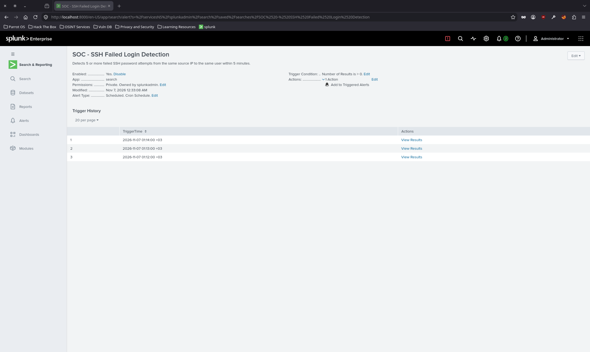

# 🛡️ CyberSecurity Projects

<div align="center">


> **Siber güvenlik mühendisliği portföyü:** SOC/SIEM, Detection Engineering, EDR, Firewall, Vulnerability Management ve Penetration Testing.
>
> OakAcademy eğitimi ve bağımsız, yetkili laboratuvar çalışmalarından oluşan uygulamalı proje raporları; komutlar, tespit kuralları ve doğrulama kanıtlarıyla birlikte sunulmuştur.

[](https://tryhackme.com/p/BY-EKREM)
[](https://oakacademy.de/en/)
[](https://github.com/ekremtunckir35)
[](https://www.linkedin.com/in/ekremtunçkır)

</div>

---

## 🎯 Portföy Özeti

| Alan | Uygulamalı çalışma |
|---|---|
| **SOC / SIEM** | Splunk Enterprise, Universal Forwarder, Linux SSH log analizi ve Scheduled Alert |
| **Detection Engineering** | SPL korelasyon ve eşik kontrolü; Sigma/pySigma otomasyonu |
| **Blue Team** | Sophos EDR, FortiGate politikaları, log gözlemlenebilirliği |
| **Vulnerability Management** | Nmap, Nessus ve risk önceliklendirme |
| **Offensive Security** | İzinli laboratuvarda exploit doğrulama ve privilege escalation |

> **Öne çıkan yeni çalışma:** [Proje 06 — Splunk SOC / SSH Failed Login Detection](./06-Splunk_SOC-SSH-Failed-Login-Detection/) · 3 Linux endpoint · 2.207 log olayı (anlık sorgu) · 5 dakikada 5 başarısız SSH girişi · **3 doğrulanmış alarm tetiklenmesi**.

## 📁 Proje Listesi

| # | Proje | Teknoloji | Süre | Sonuç |
|---|-------|-----------|------|-------|
| 01 | [🔐 EDR — Sophos Endpoint Detection & Response](./01-EDR-Sophos/) | Sophos Central, XDR, DLP, Zero Trust | Nisan 2026 (9 gün) | ✅ Tamamlandı |
| 02 | [🔥 Firewall — FortiGate Güvenlik Politikası](./02-FortiGate-Firewall/) | FortiGate, IPS, Web Filter, App Control | Nisan 2026 (~2 hafta) | ✅ Tamamlandı |
| 03 | [🔍 Vulnerability Management — Nmap & Nessus](./03-Vulnerability-Management/) | Nmap NSE, Tenable Nessus, CVSS, VPR, EPSS | Nisan 2026 (5 gün) | ✅ Tamamlandı |
| 04 | [🔴 Exploitation & Pentest — Shellshock, Privesc, Hash Cracking](./04-Exploitation-Pentest-Project/) | Nmap, Metasploit, Nessus, John the Ripper | Mayıs 2026 (~9 gün) | ✅ Tamamlandı |
| 05 | [🧠 Detection Engineering Automation — Claude Code & Sigma](./05-Claude-Code-Sigma-Automation/) | Claude Code, Sigma, pySigma, Python, PostToolUse Hooks | Ağustos 2026 | ✅ Tamamlandı |
| 06 | [📡 SOC / SIEM — Splunk SSH Failed Login Detection](./06-Splunk_SOC-SSH-Failed-Login-Detection/) | Splunk Enterprise, Universal Forwarder, SPL, Linux, MITRE ATT&CK | Kasım 2026 | ✅ Detection & Alert doğrulandı |

---

## 🔐 Proje 01 — Sophos EDR

<div align="center">


</div>

**Kurs:** OakAcademy 13. Batch | **Süre:** 9 gün | **Platform:** Sophos Central

| Performans | Sonuç |
|-----------|-------|
| TryHackMe Rooms | ✅ %100 |
| CTF Tamamlama | ✅ %100 |
| Quiz Ortalaması | 94 / 100 |
| Modül Sınavı | 93 / 100 |

**Uygulanan Güvenlik Katmanları:**

```
✅ Threat Protection  — Deep Learning ML, CryptoGuard, Exploit Prevention
✅ Web Control        — Kumar, P2P, Sosyal Ağlar engelleme
✅ Application Control — TeamViewer, uTorrent engelleme
✅ DLP                — TC Kimlik No, Kredi Kartı sızıntı engeli
✅ EICAR Test         — Malware tespit & temizleme doğrulaması
✅ Admin Isolation    — Endpoint ağdan izole etme
✅ Live Query         — Proaktif tehdit avcılığı (ağ bağlantıları + Registry)
```

📂 [Proje Detayları ve Raporlar →](./01-EDR-Sophos/)

---

## 🔥 Proje 02 — FortiGate Firewall

<div align="center">


</div>

**Kurs:** OakAcademy 13. Batch | **Süre:** ~2 Hafta | **Platform:** FortiGate VM — FortiOS

**Ağ Segmentasyonu:**

```
Finance Subnet  ──┐
Sales Subnet    ──┤──▶  FortiGate FW  ──▶  WAN / İnternet
IT Subnet       ──┤         │
DMZ (WinSrv)   ──┘    Least Privilege
```

**Tamamlanan 16 Task:**

```
✅ Task 01 — Linux SSH & ICMP erişimi (subnet içi)
✅ Task 02 — Windows RDP erişimi (subnet içi)
✅ Task 03 — Log kayıtlarıyla doğrulama
✅ Task 04 — Web sunucusu kurulumu + LAN erişimi (80, 8080, 9090)
✅ Task 05 — Virtual-IP / Port Forwarding
✅ Task 06 — LAN1 & LAN2 internet erişimi (NAT)
✅ Task 07 — LAN1 kısıtlı internet (URL Filter)
✅ Task 08 — LAN2 AWS engelleme (FQDN Filter)
✅ Task 09 — Uygulama kontrolü (Instagram, Gmail, Facebook engel)
✅ Task 10 — Web Filtering (kategori bazlı)
✅ Task 11 — Antivirus (EICAR testi)
✅ Task 12 — IPS (Intrusion Prevention System)
✅ Task 13 — DNS Filtering
✅ Task 14 — DMZ Windows Server politikası
✅ Task 15 — Linux web sunucusu log izleme
✅ Task 16 — Genel güvenlik politikası ve özet
```

📂 [Proje Detayları ve Raporlar →](./02-FortiGate-Firewall/)

---

## 🔍 Proje 03 — Vulnerability Management

<div align="center">


</div>

**Kurs:** OakAcademy 13. Batch | **Süre:** 5 gün | **Hedefler:** Windows 10, Linux Ubuntu, Metasploitable

**Tamamlanan 9 Aşama:**

```
✅ Aşama 1 — Topoloji ve hedef tanımlama (Nmap)
✅ Aşama 2-4 — Manuel port/servis/OS tarama + NSE vulnerability scriptleri
               → 31 TCP + 7 UDP açık port | 9 CVE | 3 zayıf kimlik doğrulama
✅ Aşama 5 — Nessus Kimliksiz Tarama → 45 bulgu (7 Critical, 7 High)
✅ Aşama 6 — Nessus Kimlikli Tarama  → 167 bulgu (30 Critical, 97 High)
✅ Aşama 7 — Karşılaştırma: Kimlikli tarama %271 daha fazla bulgu tespit etti
✅ Aşama 8 — Windows Authentication Failed simulasyonu + 9 neden analizi + çözüm
✅ Aşama 9 — Kapsamlı rapor hazırlama
```

**Risk Skorlama Sistemleri:**

| Sistem | Sorusu |
|--------|--------|
| CVSS v3.0 | "Bu zafiyet ne kadar şiddetli?" |
| VPR (Tenable) | "Önümüzdeki 28 günde önce neyi düzeltmeliyim?" |
| EPSS | "Bu zafiyet 30 günde istismar edilecek mi?" |

**Kimliksiz vs Kimlikli Tarama Karşılaştırması:**

| Metrik | Kimliksiz | Kimlikli | Artış |
|--------|-----------|----------|-------|
| Toplam Bulgu | 45 | 167 | **+271%** |
| Critical | 7 | 30 | **+329%** |
| High | 7 | 97 | **+1.286%** |

📂 [Proje Detayları ve Rapor →](./03-Vulnerability-Management/)

---

## 🔴 Proje 04 — Exploitation & Penetration Testing

<div align="center">


</div>

**Kurs:** OakAcademy 13. Batch | **Süre:** ~9 gün | **Hedef:** Ubuntu 22.04 LTS (Kernel 5.15.0-67)

**Saldırı Zinciri (Kill Chain):**

```
Nmap Recon → FTP Anonymous → Shellshock RCE → Meterpreter (www-data)
→ SUID find → Root (euid=0) → Hash Crack → SSH Doğrulama → Nessus Credentialed Scan
```

**Tamamlanan 6 Aşama:**

```
✅ Aşama 1 — Keşif: Nmap (quick + full + vuln), FTP anonymous, web enumeration
✅ Aşama 2 — İlk Erişim: Shellshock (CVE-2014-6271) → Meterpreter oturumu
✅ Aşama 3 — Yetki Yükseltme: SUID /usr/bin/find → root erişimi
✅ Aşama 4 — Post-Exploitation: Hash çıkarma → John the Ripper → parola kırma
✅ Aşama 5 — Nessus: Uncredentialed (28) vs Credentialed (54) → %93 artış
✅ Aşama 6 — Profesyonel pentest raporu hazırlama
```

| Metrik | Sonuç |
|--------|-------|
| Tespit Edilen Zafiyet | 8 (2 Critical, 3 High, 2 Medium, 1 Low) |
| Exploit Edilen | Shellshock (CVE-2014-6271) |
| Root Erişimi | ✅ SUID /usr/bin/find → euid=0 |
| Hash Kırma | ✅ yescrypt → John the Ripper |
| Nessus Karşılaştırma | Uncred: 28 zafiyet → Cred: 54 zafiyet (+93%) |

📂 [Proje Detayları ve Rapor →](./04-Exploitation-Pentest-Project/)

---

## 🧠 Proje 05 — Detection Engineering Automation

**Kurs:** OakAcademy 13. Batch | **Süre:** Ağustos 2026 | **Platform:** Claude Code CLI, Python

Simüle edilmiş Sysmon Event ID 1 (process creation) logları kullanılarak detection engineering iş akışı otomatize edildi. Beş benign ve bir simulated suspicious event üretildi. `certutil.exe` ile URL üzerinden dosya indirme davranışı için bir Sigma kuralı yazıldı ve PyYAML ile pySigma `SigmaCollection.load_ruleset` kullanılarak parse doğrulaması yapıldı.

`test_detection.py` ile gerçekleştirilen detection testinde pozitif testte şüpheli olay tespit edildi, negatif testte beş benign olay yanlış alarm üretmeden geçti. Bu script genel amaçlı bir Sigma engine değildir; yalnızca bu prototipteki detection mantığını test eder.

Claude Code PostToolUse hook, `Write` veya `Edit` işleminden sonra `rules/` dizini altındaki `.yml` ve `.yaml` dosyalarını otomatik olarak PyYAML ve pySigma ile doğrular. Geçersiz YAML durumunda exit code 2 ile blocking error üretilir. Hook post-write validation uygular; dosya yazılmadan önce engellemez.

| Kontrol | Sonuç |
|---|---|
| YAML syntax | ✅ Geçti |
| pySigma parse | ✅ Geçti |
| Pozitif detection testi | ✅ 1 olay |
| Negatif detection testi | ✅ 5 benign olay |
| PostToolUse başarı testi | ✅ Geçti |
| PostToolUse blocking-error testi | ✅ Geçti |

📂 [Proje Detayları, Kodlar ve Kanıtlar →](./05-Claude-Code-Sigma-Automation/)

---

## 📡 Proje 06 — Splunk SOC / SSH Failed Login Detection


**Platform:** VMware Workstation · Parrot OS (Splunk Enterprise) · Cisco Linux (`labvm`) · Kali Linux · Fedora Workstation 45

**Senaryo:** Üç Linux endpoint'inden `Universal Forwarder` aracılığıyla merkezî Splunk'a güvenlik logları gönderildi. SSH kimlik doğrulama olayları SPL ile ayrıştırılarak, **aynı host + kaynak IP + kullanıcı için son 5 dakikada en az 5 başarısız parola girişini** arayan Scheduled Alert oluşturuldu.

| Doğrulama | Laboratuvar kanıtı |
|---|---|
| Merkezî log toplama | `ciscovm`, `kalivm`, `fedoravm` indeksleri |
| Log görünürlüğü | Birleşik sorguda **2.207 event** (tek bir anlık `All time` sonucu) |
| Tespit alanları | `host`, `src_ip`, `target_user`, `failed_attempts` |
| Eşik testi | **5 başarısız SSH girişi / 5 dakika** |
| Alarm | **3 Trigger History kaydı** (01:12, 01:13, 01:14) |
| ATT&CK eşlemesi | [T1110.001 — Password Guessing](https://attack.mitre.org/techniques/T1110/001/) |
| Ek analiz | False positive/false negative, zaman penceresi, alarm tekrarı ve troubleshooting |

**Otomatik alarmın kanıtı:**



**Teknik çıkarım:** Üç tetiklenme, üç bağımsız saldırı anlamına gelmez; örtüşen Scheduled Alert pencereleri aynı olayları tekrar yakalayabilir. `Throttle` ve ek korelasyon kuralları bir sonraki iyileştirme olarak belirlenmiş, **henüz uygulanmış olarak raporlanmamıştır**.

📂 **[Tam vaka analizi, 21 ekran görüntüsü, SPL sorguları ve yapılandırma örnekleri →](./06-Splunk_SOC-SSH-Failed-Login-Detection/)**

---

## 📊 Genel İlerleme

```
Belgelenen Projeler : 6
İlk 5 Projedeki Görev: 8 (EDR) + 16 (Firewall) + 9 (Vuln. Mgmt.) + 6 (Pentest) + 6 (Detection Automation) = 45
Proje 06            : Splunk SOC / SSH Detection vaka analizi — otomatik alarm doğrulandı
Sonraki İyileştirme : Alert throttling, indeksleme gecikmesi ölçümü ve başarılı SSH korelasyonu
```

---

## 🛠️ Kullanılan Teknolojiler


---

## ⚠️ Yasal Uyarı

Tüm projeler **kontrollü eğitim ortamlarında ve yetkilendirilmiş sistemlerde** yürütülen çalışmaları belgelemektedir. Splunk vaka analizindeki `10.44.0.0/24` adresleri yalnızca **izole laboratuvarın özel ağ IP'leridir**; bu dokümanlarda tamamının `[REDACTED]` olduğu iddia edilmez. Parola, token, özel anahtar veya canlı üretim altyapısı bilgileri paylaşılmamalıdır.

---

<div align="center">

[](https://www.linkedin.com/in/ekremtunçkır)
[](https://tryhackme.com/p/BY-EKREM)
[](https://github.com/ekremtunckir35)

*"Bir sistemi korumak için önce onu anlamak gerekir."*

</div>
